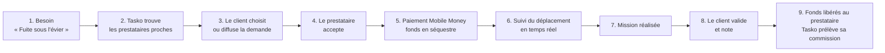

# Tasko — Description officielle du projet

> **Tasko — La marketplace des services, compétences et petits jobs du quotidien.**
> *« Le Yango des petits jobs du quotidien »*


---

## Sommaire

1. [Présentation](#1-présentation)
2. [Pitch en une phrase](#2-pitch-en-une-phrase)
3. [Problématique](#3-problématique)
4. [La solution Tasko](#4-la-solution-tasko)
5. [Fonctionnement pas à pas](#5-fonctionnement-pas-à-pas)
6. [Catégories de services (dynamiques)](#6-catégories-de-services-dynamiques)
7. [Système de confiance](#7-système-de-confiance)
8. [Proposition de valeur par acteur](#8-proposition-de-valeur-par-acteur)
9. [Positionnement et concurrence](#9-positionnement-et-concurrence)
10. [Les 16 écrans de la maquette](#10-les-16-écrans-de-la-maquette)
11. [Vision long terme](#11-vision-long-terme)
12. [V2 — Garantie de paiement, modes de mission, entreprises et immobilier](#12-v2--garantie-de-paiement-modes-de-mission-entreprises-et-immobilier)

---

## 1. Présentation

**Tasko** est une application mobile (Android / iOS / Web) accompagnée d'un back-office d'administration, qui met en relation, **en temps réel et par géolocalisation**, des personnes ayant besoin d'un service (réparer une fuite, se faire tresser, faire saisir un mémoire, monter une vidéo, déménager un meuble…) avec des prestataires **proches, disponibles et notés**.

Tasko n'est **pas un annuaire** : c'est une **marketplace transactionnelle de services de proximité**. La plateforme intervient sur toute la chaîne :

| Étape | Annuaire classique | Tasko |
|---|---|---|
| Trouver quelqu'un | Liste de contacts | Prestataires **proches, disponibles, classés** par un score de pertinence |
| Choisir | Au hasard / bouche-à-oreille | Notes, avis, missions réalisées, niveau de vérification, prix indicatif |
| Se coordonner | Appels, WhatsApp | Chat intégré, partage de position, **suivi du déplacement en temps réel** |
| Payer | Cash, sans garantie | **Mobile Money** payé **avant** le travail, **fonds en séquestre** ; libération à la validation ou **automatiquement après 48 h** |
| Après la mission | Rien | Notation croisée, historique, litiges arbitrés |

Le projet est conçu pour le **Cameroun** (lancement à **Yaoundé** et **Douala**, puis Bafoussam, Limbe, Kribi), avec une ambition d'extension à l'**Afrique centrale** (zone CEMAC, même monnaie FCFA).

Il est également structuré pour être valorisé comme **projet de Master en informatique** : architecture distribuée, temps réel, géolocalisation, paiement asynchrone par webhooks, machine à états, back-office BI, et feuille de route IA (matching, prévision de la demande, détection de fraude).

---

## 2. Pitch en une phrase

> **« J'ai besoin de quelqu'un → Tasko trouve les prestataires proches (ou je désigne celui que je connais déjà) → je paie par Mobile Money, l'argent est bloqué → il vient, je lui donne mon code de démarrage → je valide → il est payé (automatiquement après 48 h si je ne fais rien). »**

Version investisseur :

> *Tasko est la place de marché transactionnelle qui organise le marché informel des services du quotidien au Cameroun : elle rend chaque compétence trouvable, chaque prestataire évaluable et chaque paiement sécurisé — et prélève une petite commission sur chaque job réalisé.*

---

## 3. Problématique

### 3.1 Côté client (celui qui a un besoin)

| Problème | Conséquence concrète |
|---|---|
| **Trouver vite** quelqu'un de compétent et proche | Des heures perdues à appeler des numéros, à demander dans des groupes WhatsApp ou au quartier |
| **Aucune garantie de fiabilité** | Peur de l'arnaque, du travail mal fait, de l'inconnu qui entre chez soi |
| **Prix opaques** | Négociation au cas par cas, sentiment d'être « surfacturé » |
| **Paiement risqué** | Avance en cash sans recours si le prestataire ne vient pas ou bâcle le travail |
| **Aucun suivi** | « Il arrive dans 10 minutes »… deux heures plus tard |
| **Aucune mémoire** | Impossible de retrouver le bon plombier de l'an dernier ou de savoir ce que d'autres en pensent |

### 3.2 Côté prestataire (celui qui a une compétence)

| Problème | Conséquence concrète |
|---|---|
| **Visibilité limitée** au quartier et au bouche-à-oreille | Revenus irréguliers, journées sans client |
| **Le diplôme ferme des portes** | Les « débrouillards » compétents mais non diplômés sont invisibles pour une clientèle plus large |
| **Aucune réputation transportable** | Un excellent travail ne se transforme pas en preuve visible pour de nouveaux clients |
| **Impayés et clients qui disparaissent** | Déplacements non payés, travail fait sans être réglé |
| **Pas d'outil de gestion** | Aucun historique de revenus, aucun planning, aucune vitrine (portfolio) |

### 3.3 Le constat de fond

Une très grande partie de l'économie des services de proximité au Cameroun est **informelle**, fonctionne **au cash** et **par réseau personnel**. Dans le même temps, le **Mobile Money** (MTN MoMo, Orange Money) et le **smartphone Android** se sont largement diffusés en milieu urbain. *(Ordres de grandeur à confirmer avec des sources récentes avant toute présentation officielle : rapports GSMA « State of the Industry on Mobile Money », données BEAC sur les paiements électroniques, Institut National de la Statistique du Cameroun, Banque mondiale — Findex.)*

**Tasko exploite cette double infrastructure — smartphone + Mobile Money — pour formaliser, sécuriser et fluidifier le marché des petits services.**

---

## 4. La solution Tasko

Une **application unique** pour tout le monde, avec une **bascule « Mode Prestataire »** : chaque utilisateur peut être client un jour et prestataire le lendemain.

```
┌───────────────────────────────────────────────────────────────────┐
│                         APPLICATION TASKO                          │
│                                                                   │
│   MODE CLIENT                          MODE PRESTATAIRE           │
│   • Rechercher / publier un besoin     • Activer ses compétences  │
│   • Voir les prestataires sur carte    • Passer « en ligne »      │
│   • Chat + suivi temps réel            • Recevoir des demandes    │
│   • Payer en séquestre (MoMo / OM)     • Partager sa position     │
│   • Valider et noter                   • Encaisser, voir ses gains│
│                                        • Tasko Pro / Boost        │
└───────────────────────────────────────────────────────────────────┘
                  │                                  │
                  ▼                                  ▼
┌───────────────────────────────────────────────────────────────────┐
│   API Tasko · temps réel · séquestre via agrégateur de paiement   │
└───────────────────────────────────────────────────────────────────┘
                  │
                  ▼
┌───────────────────────────────────────────────────────────────────┐
│ BACK-OFFICE ADMIN : catégories dynamiques, utilisateurs, litiges, │
│ tarification, statistiques, promotions, villes                    │
└───────────────────────────────────────────────────────────────────┘
```

Les quatre piliers :

1. **Proximité** — géolocalisation, carte (OpenStreetMap), distance et temps d'arrivée estimé.
2. **Confiance** — réputation croisée, vérification à 5 niveaux, paiement en séquestre.
3. **Simplicité** — parcours en quelques écrans, pensé pour Android d'entrée de gamme et réseau 3G.
4. **Ouverture** — catégories 100 % pilotées par l'administrateur : n'importe quelle compétence peut devenir un service.

---

## 5. Fonctionnement pas à pas



| # | Étape | Qui | Détail | Écran maquette |
|---|---|---|---|---|
| 1 | Exprimer un besoin | Client | Recherche (« Plomberie ») ou choix d'une catégorie ; description, photo, adresse, urgence (`maintenant`, `aujourd'hui`, `planifié`), budget indicatif | 3 · Accueil |
| 2 | Trouver | Tasko | Prestataires en ligne dans le rayon (10 km par défaut), triés par **score de matching** (distance, note, expérience, disponibilité, mise en avant, Pro) | 4 · Carte |
| 3 | Choisir | Client | Consulte profil, avis, portfolio, prix de départ ; contacte ou envoie une demande directe — ou **diffuse** la demande à tous les prestataires proches | 5 · Détail, 9 · Profil |
| 4 | Accepter | Prestataire | Reçoit la demande en temps réel, l'accepte (éventuellement avec un prix ajusté) | 14 · Notifications |
| 5 | Payer | Client | Voit le récapitulatif (prix + frais de service 5 %), paie par MTN MoMo / Orange Money / carte ; les fonds sont **bloqués en séquestre** | 7 · Paiement |
| 6 | Suivre | Client | Statuts « En route → Sur place → Mission → Terminé », position du prestataire et ETA en direct ; chat et appel | 8 · Suivi, 6 · Chat |
| 7 | Réaliser | Prestataire | Effectue le service et déclare « Terminé » | 8 · Suivi |
| 8 | Valider | Client | Confirme la bonne exécution, note (1 à 5 étoiles) et commente | 8 · Job terminé |
| 9 | Être payé | Tasko | Libère le montant au prestataire sur son Mobile Money ; conserve les frais de service (et la commission éventuelle) | 15 · Mes paiements |

En cas de problème, le client ou le prestataire **ouvre un litige** : les fonds restent bloqués jusqu'à l'arbitrage par l'administrateur sur preuves (libération, remboursement ou **partage**).

> **V2** : entre les étapes 5 et 7 s'ajoutent le **code de démarrage** (le client le donne au prestataire sur place, qui le saisit pour commencer) et les **photos de fin** ; à l'étape 8, si le client ne réagit pas, les fonds sont **libérés automatiquement 48 h** après « Terminé ». Le client peut aussi désigner directement un prestataire déjà connu, ou lancer un appel d'offres. Détails : [§ 12](#12-v2--garantie-de-paiement-modes-de-mission-entreprises-et-immobilier) et [08 — Confiance, paiement et trésorerie](08-confiance-paiement-et-tresorerie.md).

---

## 6. Catégories de services (dynamiques)

> ⚙️ **Principe fondamental : aucune catégorie n'est codée en dur.** Les catégories, sous-services, icônes, couleurs, ordre d'affichage et statut (actif / inactif) sont **créés et modifiés par l'administrateur depuis le back-office** (écrans 12 et 13), sans mise à jour de l'application. Une catégorie **« Autre service »** permet à un client ou à un prestataire de saisir un service non listé ; ces saisies sont **agrégées et remontées à l'administrateur** sous forme de suggestions (avec leur fréquence), qui peut alors créer la catégorie en un clic.

Catalogue de départ proposé (indicatif, modifiable à tout moment) :

| Catégorie | Exemples de sous-services |
|---|---|
| 🏗️ **Bâtiment & Chantier** | Maçonnerie, carrelage, plomberie, électricité, peinture, menuiserie, soudure, ferronnerie, manœuvres de chantier, étanchéité |
| 🏠 **Maison & Maintenance** | Ménage, repassage, réparation d'appareils, climatisation / froid, dépannage électroménager, montage de meubles, désinsectisation |
| 💅 **Beauté & Bien-être** | Coiffure, tresses, tissage, nattes, manucure, pédicure, maquillage, soins du visage, massage, barbier, extension de cils |
| 💻 **Informatique & Digital** | Dépannage PC, installation logiciels, réparation téléphone, design graphique, montage vidéo, création de sites, gestion de réseaux sociaux |
| 🎓 **Études & Éducation** | Répétiteurs (primaire, secondaire, supérieur), préparation aux examens, cours de langues, saisie de documents, rédaction et mise en forme de CV, impression |
| 🚚 **Logistique & Manutention** | Déménagement, transport de colis, manutention, coursier moto |
| 🛒 **Courses & Livraison** | Courses au marché, achats pour le compte du client, livraison de proximité |
| 🚗 **Automobile** | Mécanique, électricité auto, vulcanisation, lavage à domicile, chauffeur à la journée |
| 👗 **Mode & Couture** | Couture, retouches, création de tenues, broderie |
| 🎉 **Événementiel** | Décoration, traiteur, DJ, photographe, vidéaste, animateur, location de matériel, serveurs |
| 🌿 **Jardinage** | Entretien de jardin, débroussaillage, élagage, aménagement |
| 👶 **Services à la personne** | Garde d'enfants, aide aux personnes âgées, cuisine à domicile |
| 🐾 **Animaux** | Garde, toilettage, soins de base |
| 🔐 **Sécurité** | Gardiennage ponctuel, serrurerie, installation de caméras |
| ➕ **Autre service** | Saisie libre → suggestion transmise à l'administrateur |

Points clés :
- **Un prestataire peut déclarer plusieurs compétences**, chacune avec son prix de départ (ex. un étudiant : *Saisie de documents* 2 000 FCFA, *Design graphique* 5 000 FCFA, *Montage vidéo* 10 000 FCFA).
- La recherche sur une catégorie parente inclut tous ses sous-services.
- Une catégorie ayant déjà des missions ne peut pas être supprimée, seulement **désactivée** (préservation de l'historique).

---

## 7. Système de confiance

La confiance est le **produit principal** de Tasko. Elle repose sur trois mécanismes complémentaires.

### 7.1 Réputation croisée

- Après chaque mission, le **client note le prestataire** (1 à 5 étoiles + commentaire), et le **prestataire peut noter le client** (ponctualité du paiement, respect, exactitude de la demande).
- Le profil affiche : **note moyenne**, **nombre d'avis**, **missions réalisées**, **taux de complétion**.
- Seules les missions **réellement payées et terminées via Tasko** peuvent être notées → les avis ne peuvent pas être fabriqués hors plateforme.
- L'administrateur peut modérer (supprimer) un avis abusif.

### 7.2 Vérification à 5 niveaux

| Niveau | Intitulé | Comment on l'obtient | Badge |
|---|---|---|---|
| **1** | Compte créé | Inscription | — |
| **2** | Téléphone vérifié | Code OTP par SMS | ✔ Téléphone |
| **3** | Identité vérifiée | Pièce d'identité (CNI / passeport) + selfie contrôlés (KYC) | ✔ Identité |
| **4** | Compétence vérifiée | Diplôme, certificat, test pratique, ou preuves (portfolio, références) validés par Tasko | ✔ Compétence |
| **5** | Prestataire recommandé | Historique solide : nombre de missions, note élevée, faible taux d'annulation, aucun litige perdu | ⭐ Recommandé |

> Le niveau 4 **ne requiert pas forcément de diplôme** : un « débrouillard » peut le démontrer par un test pratique ou un portfolio. **Tasko valorise la compétence et la réputation, pas le diplôme.**

### 7.3 Paiement en séquestre

```
Client paie 5 250 FCFA ──▶ [ Fonds bloqués ] ──(client valide)──▶ Prestataire reçoit 5 000 FCFA
                               │                                  Tasko conserve 250 FCFA
                               └──(litige / annulation)──▶ Arbitrage admin → libération ou remboursement
```

- Le client **n'a pas peur de payer d'avance** : l'argent n'est versé que si le travail est fait.
- Le prestataire **sait que l'argent existe** avant de se déplacer : fini les déplacements gratuits. En V2, l'app l'empêche même de partir tant que l'argent n'est pas bloqué.
- **V2 — le client malhonnête ne peut plus « ne pas payer »** : il a déjà payé ; une fois le prestataire arrivé il ne peut plus annuler ; s'il ne valide pas, l'argent est libéré automatiquement après 48 h ; seul un litige **avec preuves**, arbitré par Tasko, peut bloquer le paiement. Voir [08 — Confiance, paiement et trésorerie](08-confiance-paiement-et-tresorerie.md).
- ⚠️ **Point réglementaire** : la détention de fonds pour compte de tiers est une activité encadrée. En production, le séquestre doit être opéré **par ou avec un partenaire agréé** (agrégateur / établissement de paiement / banque) — voir [02-modele-economique.md § Risques](02-modele-economique.md#9-risques-et-conditions-de-succès). Le premier lot technique fonctionne avec un **simulateur de paiement** (`mock`).

---

## 8. Proposition de valeur par acteur

| Acteur | Ce qu'il obtient |
|---|---|
| **Client particulier** | Un prestataire fiable, proche et disponible en quelques minutes ; prix transparent ; argent protégé jusqu'à la validation ; suivi en direct ; historique et favoris. |
| **Prestataire (artisan, coiffeuse, réparateur…)** | Un flux de clients au-delà de son quartier ; une vitrine (profil, portfolio, avis) ; la garantie d'être payé ; un tableau de ses revenus ; la possibilité de se démarquer (Pro, Boost). |
| **Étudiant** | Un revenu complémentaire compatible avec les cours (répétition, saisie, CV, design, montage, informatique) ; disponibilités choisies jour par jour ; une première « expérience » vérifiable et notée. |
| **« Débrouillard » sans diplôme** | Une reconnaissance fondée sur le **travail réel** : chaque mission réussie construit une réputation qui vaut référence ; accès à une clientèle qui ne l'aurait jamais trouvé. |
| **Entreprise (B2B — Tasko Business)** | Un vivier de prestataires qualifiés pour maintenance, nettoyage, petits travaux, événementiel, renfort ponctuel ; **appels d'offres** pour comparer plusieurs devis ; **paiement par jalons** pour les chantiers ; compte Business (NIU, RCCM) et **reçus** comptables par mission ; historique et justificatifs. |
| **Propriétaire immobilier (bailleur, agence, syndic)** | Ses **biens** enregistrés avec l'historique des interventions et les **dépenses par bien** ; **missions récurrentes** (ménage hebdomadaire, jardinage, maintenance mensuelle) confiées à des **prestataires attitrés** ; reçus pour justifier les charges. |
| **Propriétaire de la plateforme** | Une commission sur chaque transaction, des revenus récurrents (abonnements Pro, Business), de la publicité interne (Boost), et un **actif stratégique** : réseau de prestataires, base clients, données de demande, marque. Détails dans [02-modele-economique.md](02-modele-economique.md). |

---

## 9. Positionnement et concurrence

> Les éléments ci-dessous sont **qualitatifs**. Aucun chiffre sur les concurrents n'est avancé ; une étude terrain est recommandée avant toute levée de fonds.

### 9.1 Les alternatives actuelles

| Alternative | Forces | Limites que Tasko adresse |
|---|---|---|
| **Bouche-à-oreille, voisinage** | Confiance personnelle, gratuit | Réseau restreint, lent, aucune garantie de paiement ni de qualité, aucune traçabilité |
| **Groupes WhatsApp / Facebook, Marketplace Facebook** | Gratuit, très répandu, audience large | Pas de géolocalisation fine, pas de réputation vérifiée, arnaques fréquentes, aucun paiement sécurisé, pas de suivi |
| **Annuaires en ligne / petites annonces** | Visibilité, catégorisation | Statique : pas de disponibilité temps réel, pas de transaction, pas de séquestre, avis rarement vérifiés |
| **Plateformes de VTC et de livraison** | Ont habitué le public au modèle « commande → suivi → paiement mobile » | Centrées sur le transport / la livraison ; ne couvrent pas la diversité des compétences du quotidien |
| **Plateformes internationales de services (type TaskRabbit, Thumbtack, Upwork/Fiverr pour le digital)** | Modèles éprouvés de marketplaces de services | Peu ou pas adaptées au contexte local : Mobile Money, FCFA, Android d'entrée de gamme, 3G, prestataires informels, langues et usages locaux |

### 9.2 Positionnement de Tasko

```
                    Transactionnel (paiement, séquestre, suivi)
                                   ▲
                                   │        ★ TASKO
              Plateformes VTC /    │      (toutes compétences
              livraison            │       de proximité, local)
                                   │
 Spécialisé  ◀─────────────────────┼─────────────────────▶  Multi-services
 (1 métier)                        │
              Annuaires métiers    │      Groupes WhatsApp /
                                   │      Facebook, annonces
                                   ▼
                     Simple mise en relation (contact)
```

**Avantages distinctifs :**
1. **Transactionnel de bout en bout** (paiement + séquestre + suivi) là où les alternatives s'arrêtent au contact.
2. **Catalogue illimité et piloté par la demande** (catégories dynamiques + suggestions « Autre service »).
3. **Inclusion** : étudiants et débrouillards sont des prestataires de premier rang.
4. **Conçu pour le terrain** : Mobile Money natif, FCFA, faible bande passante, Android modeste, français / anglais.
5. **Effet réseau local** : chaque nouveau prestataire améliore le service pour les clients du quartier, et inversement.

---

## 10. Les 16 écrans de la maquette


> Remarque : la planche numérote deux vignettes « 8 » (Suivi en temps réel et Job terminé) ; elles sont désignées ici **8a** et **8b**.

| # | Écran | Description en une ligne |
|---|---|---|
| 1 | **Écran de démarrage** | Logo, slogan « La marketplace des services, compétences et petits jobs du quotidien » et 4 promesses (Demande un service · Trouve un job · Paie en ligne · C'est sécurisé). |
| 2 | **Onboarding** | « Besoin d'aide ? Trouvez un professionnel près de chez vous ! » — carrousel de présentation avant inscription. |
| 3 | **Accueil** | Barre de recherche, ville courante, bannière, grille des catégories dynamiques et barre de navigation (Accueil, Mes jobs, +, Messages, Profil). |
| 4 | **Carte des prestataires** | Prestataires proches géolocalisés sur la carte, filtres (proximité, note), fiche résumée avec distance, note et prix de départ. |
| 5 | **Détail d'un service** | Photo, prestataire, note, distance, « À propos », services proposés et prix, bouton Contacter. |
| 6 | **Chat en temps réel** | Messagerie entre client et prestataire avec partage de position sur mini-carte. |
| 7 | **Paiement sécurisé** | Récapitulatif (5 000 FCFA + frais 5 % = 5 250 FCFA), choix MoMo / Orange Money / carte, mention du déblocage après validation. |
| 8a | **Suivi en temps réel** | Trajet du prestataire sur la carte, temps d'arrivée estimé et frise En route → Sur place → Mission → Terminé, bouton Appeler. |
| 8b | **Job terminé** | Confirmation, notation 5 étoiles, commentaire, « Valider et payer » et récapitulatif du montant. |
| 9 | **Profil prestataire** | Photo, note, distance, compétences, avis clients, boutons Contacter et Suivre. |
| 10 | **Profil prestataire étudiant / débrouillard** | « Étudiant / Informaticien » : services proposés (saisie, design, montage vidéo…), disponibilités par jour, réalisations. |
| 11 | **Tableau de bord admin** | Indicateurs (utilisateurs, prestataires, jobs du jour, chiffre d'affaires) et activité récente. |
| 12 | **Gestion des catégories (admin)** | Liste des catégories avec recherche, statut actif/inactif et bouton « Ajouter une catégorie ». |
| 13 | **Ajouter une catégorie (admin)** | Formulaire : nom, description, icône, statut, position — création sans toucher au code. |
| 14 | **Notifications** | Flux filtrable (Toutes, Jobs, Messages, Système) : nouveau job, paiement reçu, message, validation, inscription. |
| 15 | **Menu utilisateur** | Mon profil, Mes jobs, Mes paiements, Mes avis, Paramètres, Aide, Déconnexion (et bascule Mode Prestataire). |
| 16 | **Affiche de fin / Vision** | « Plus qu'une application, une opportunité pour tous ! » — Particuliers, Jeunes, Artisans, Entreprises. |

---

## 11. Vision long terme

| Horizon | Ambition |
|---|---|
| **Court terme** | Devenir le réflexe « j'ai besoin de quelqu'un » à Yaoundé et Douala, avec un réseau dense de prestataires vérifiés. |
| **Moyen terme** | Couvrir les principales villes du Cameroun (Bafoussam, Limbe, Kribi, Bamenda, Garoua…), lancer **Tasko Business** pour les entreprises, outiller les prestataires (agenda, devis, facturation, épargne). |
| **Long terme** | Devenir l'**infrastructure de confiance des services de proximité en Afrique centrale** (zone CEMAC) : identité professionnelle portable pour des milliers de travailleurs informels, données de demande permettant de mieux former et orienter les jeunes, services financiers adossés à l'historique de revenus (en partenariat avec des acteurs agréés). |
| **Intelligence artificielle** | Matching prédictif (distance, disponibilité, note, expérience, prix, historique), prévision de la demande par zone et par heure, recommandations de tarifs, détection de fraude et de faux avis. |

> **Plus qu'une application, une opportunité pour tous.** Tasko transforme chaque compétence en revenu et chaque besoin en mission réussie.

---

## 12. V2 — Garantie de paiement, modes de mission, entreprises et immobilier

> Référence complète : [08 — Confiance, paiement et trésorerie](08-confiance-paiement-et-tresorerie.md) et [contrat d'API § 5](05-contrat-api.md).

### 12.1 La garantie de paiement du prestataire

| Mécanisme | Effet |
|---|---|
| **Paiement avant le travail** (séquestre) | Le prestataire voit « X FCFA sécurisés par Tasko — vous pouvez y aller » avant de se déplacer ; l'app bloque le départ sinon. |
| **Code de démarrage** à 4 chiffres | Visible seulement par le client ; le prestataire le saisit pour commencer = preuve de présence et d'accord. |
| **Photos de fin** | Preuve de l'état du travail. |
| **Libération automatique après 48 h** | Le silence du client vaut acceptation. |
| **Annulation interdite une fois le prestataire arrivé** | Et frais de déplacement (1 000 FCFA par défaut) versés au prestataire si le client annule pendant qu'il est en route. |
| **Litige arbitré sur preuves** | Seul moyen de bloquer le paiement ; décision : tout au prestataire, tout au client, ou partage. |
| **Réputation du client** | Le prestataire voit la note du client et ses litiges perdus avant d'accepter ; les clients abusifs sont signalés et sanctionnés. |
| **Contacts masqués avant paiement** | Empêche le « on règle en cash après » (contournement). |

**Honnêtement** : ce qui est garanti à 100 %, c'est que **l'argent existe et est bloqué** avant le travail. Ce qui reste possible, c'est un **litige tranché sur preuves** — c'est aussi ce qui protège le client honnête contre un travail bâclé.

### 12.2 Quatre façons de créer une mission

| Mode | Pour qui | Règle clé |
|---|---|---|
| **Instantané** | Urgence, petit job | Diffusé aux prestataires proches ; **le premier qui accepte l'obtient**, les autres sont bloqués instantanément. |
| **Gré à gré direct** | « J'ai déjà mon prestataire » | **Jamais diffusé** ; le client désigne son prestataire (recherche, code Tasko `TSK-XXXXX` ou téléphone). |
| **Offre du prestataire** | Accord déjà conclu hors de l'app | Le prestataire crée la mission **au prix convenu** ; le client paie pour confirmer. |
| **Appel d'offres** | Entreprises, propriétaires, gros travaux | Plusieurs devis jusqu'à une date limite ; à l'attribution, les autres offres sont refusées et **plus personne ne peut se proposer**. |

### 12.3 Nouvelles cibles

- **Entreprises** : compte Business (raison sociale, NIU, RCCM), appels d'offres, jalons de paiement pour les chantiers, reçus comptables numérotés.
- **Propriétaires immobiliers** : biens, historique et dépenses par bien, missions récurrentes (hebdomadaire, bimensuelle, mensuelle), prestataires attitrés.

---

*Documents associés : [02 — Modèle économique](02-modele-economique.md) · [03 — Cahier des charges](03-cahier-des-charges.md) · [04 — Architecture et données](04-architecture-et-donnees.md) · [05 — Contrat d'API](05-contrat-api.md) · [06 — Parcours utilisateurs](06-parcours-utilisateurs.md) · [07 — Roadmap et lancement](07-roadmap-et-lancement.md) · [08 — Confiance, paiement et trésorerie](08-confiance-paiement-et-tresorerie.md)*
