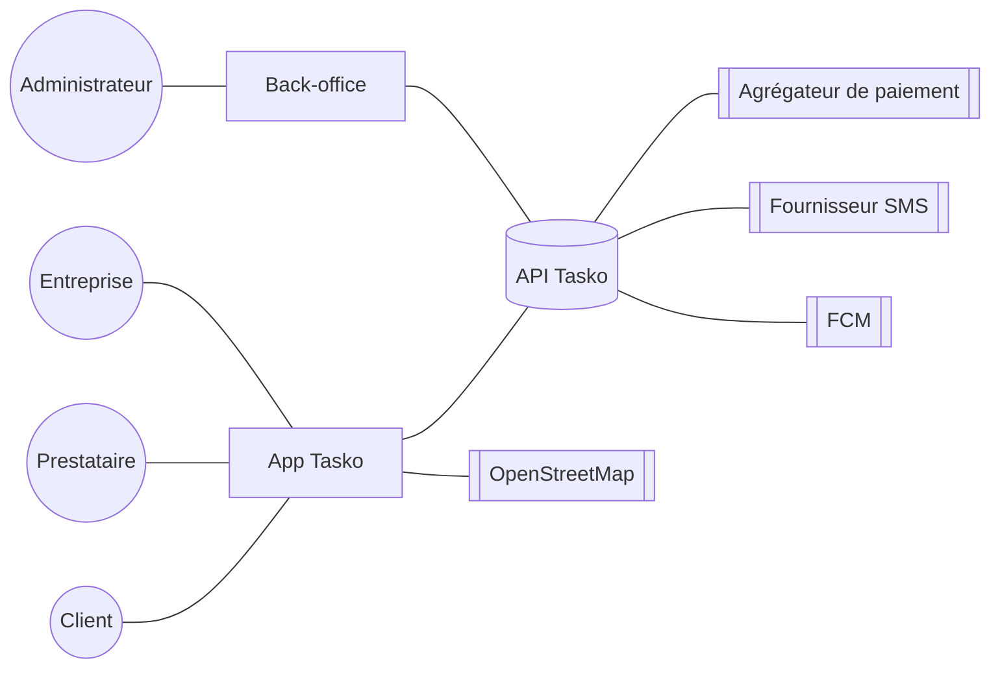
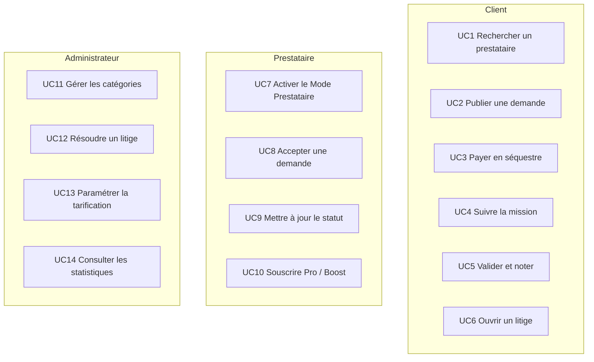

# Tasko — Cahier des charges fonctionnel et technique

| Élément | Valeur |
|---|---|
| Projet | Tasko — marketplace transactionnelle de services de proximité |
| Livrables | Application mobile Flutter (Android, iOS, Web) · Back-office admin React · API Node.js/Express · Base PostgreSQL |
| Référence technique | [05 — Contrat d'API](05-contrat-api.md) (source de vérité des objets, statuts et endpoints) |
| Zone de lancement | Cameroun — Yaoundé, Douala |
| Langues | Français (par défaut), anglais |
| Devise | FCFA (XAF), montants entiers |

---

## Sommaire

1. [Objectifs et périmètre](#1-objectifs-et-périmètre)
2. [Acteurs](#2-acteurs)
3. [Exigences fonctionnelles](#3-exigences-fonctionnelles)
4. [Exigences non fonctionnelles](#4-exigences-non-fonctionnelles)
5. [Cas d'utilisation principaux](#5-cas-dutilisation-principaux)
6. [Règles de gestion](#6-règles-de-gestion)
7. [Priorisation MoSCoW et découpage MVP / V1 / V2](#7-priorisation-moscow-et-découpage-mvp--v1--v2)
8. [Critères de recette](#8-critères-de-recette)
9. [V2 — Garantie de paiement, modes, appels d'offres, jalons, Business, immobilier, trésorerie](#9-v2--garantie-de-paiement-modes-appels-doffres-jalons-business-immobilier-trésorerie)

> **V2** : la [section 9](#9-v2--garantie-de-paiement-modes-appels-doffres-jalons-business-immobilier-trésorerie) complète et, en cas de divergence, **remplace** les exigences et règles des sections 3 et 6 (notamment EF-48, RG-13, RG-21 à RG-23, EF-121/EF-123). Elle est alignée sur le [contrat d'API § 5](05-contrat-api.md) et expliquée en langage simple dans [08 — Confiance, paiement et trésorerie](08-confiance-paiement-et-tresorerie.md).

---

## 1. Objectifs et périmètre

**Objectif** : permettre à un client de trouver, réserver, suivre, payer en séquestre et évaluer un prestataire de proximité, et permettre à l'administrateur de piloter entièrement l'offre (catégories, tarifs, utilisateurs, litiges) sans intervention technique.

**Dans le périmètre** : application unique client/prestataire (bascule « Mode Prestataire »), back-office, API, temps réel, paiement via agrégateur (simulateur au premier lot), notifications, réputation, vérification, abonnements et boosts, litiges, statistiques.

**Hors périmètre du premier lot** : portefeuille électronique interne, facturation B2B mensuelle, IA prédictive, application iOS publiée sur l'App Store (le code Flutter reste compatible), paiement par carte réel.

---

## 2. Acteurs

| Acteur | Type | Rôle | Interface |
|---|---|---|---|
| **Client** | Humain | Exprime un besoin, choisit un prestataire, paie, suit, valide, note | App mobile |
| **Prestataire** | Humain (même compte que client, mode activé) | Déclare ses compétences, se met en ligne, accepte des missions, partage sa position, est payé | App mobile (Mode Prestataire) |
| **Entreprise** | Humain / organisation | Commande des prestations pour le compte d'une structure ; peut aussi être prestataire (`provider_type = company`) | App mobile (V2 : espace Business web) |
| **Administrateur** | Humain (`is_admin`) | Gère catégories, utilisateurs, tarifs, litiges, avis, promotions, villes ; consulte les statistiques | Back-office React |
| **Agrégateur de paiement** | Système externe (NotchPay ; alternatives Campay, Monetbil ; `mock` en développement) | Encaisse les paiements Mobile Money, notifie via webhook signé, exécute les versements | Webhook + API |
| *Services tiers* | Systèmes | Fournisseur SMS (OTP), Firebase Cloud Messaging (push), OpenStreetMap (cartes) | API |

---

## 3. Exigences fonctionnelles

Priorité : **M** = Must (MVP) · **S** = Should (V1) · **C** = Could (V2) · **W** = Won't (pas avant expansion).

### 3.1 Authentification & OTP

| ID | Exigence | Priorité |
|---|---|---|
| EF-01 | L'utilisateur s'inscrit avec nom complet, téléphone, mot de passe et ville. | M |
| EF-02 | Le téléphone est normalisé au format `+237XXXXXXXXX` (9 chiffres commençant par 6 ou 2). | M |
| EF-03 | Un code OTP à 6 chiffres est envoyé par SMS pour vérifier le téléphone ; en mode développement, le code est renvoyé dans la réponse (`otp_dev_mode`). | M |
| EF-04 | La connexion se fait par téléphone + mot de passe et retourne un JWT valable 30 jours. | M |
| EF-05 | L'utilisateur peut réinitialiser son mot de passe par OTP. | S |
| EF-06 | L'utilisateur peut se déconnecter ; le jeton push est alors dissocié. | M |

### 3.2 Profils

| ID | Exigence | Priorité |
|---|---|---|
| EF-10 | L'utilisateur modifie nom, e-mail, ville et photo de profil. | M |
| EF-11 | L'utilisateur active le **Mode Prestataire** en renseignant titre, bio, type (`artisan`, `student`, `professional`, `freelancer`, `company`), années d'expérience, numéro et opérateur Mobile Money, jours de disponibilité. | M |
| EF-12 | Le prestataire déclare **plusieurs compétences** (sous-services), chacune avec un prix de départ. | M |
| EF-13 | Le prestataire ajoute des réalisations (portfolio : photo + titre). | M |
| EF-14 | Le prestataire bascule son statut **en ligne / hors ligne**. | M |
| EF-15 | Le profil public affiche note, nombre d'avis, missions réalisées, taux de complétion, niveau de vérification, compétences, disponibilités, portfolio, 5 derniers avis. | M |
| EF-16 | Le client peut suivre (favoris) un prestataire et retrouver ses favoris. | M |
| EF-17 | Le prestataire consulte ses gains : solde en séquestre, total gagné, gains du mois, historique des transactions. | M |

### 3.3 Catégories dynamiques

| ID | Exigence | Priorité |
|---|---|---|
| EF-20 | Les catégories et sous-services sont **exclusivement** chargés depuis l'API ; aucune liste n'est codée en dur dans les applications. | M |
| EF-21 | L'administrateur crée, modifie, active/désactive, réordonne catégories et sous-services (nom, description, icône parmi une liste autorisée, couleur, position). | M |
| EF-22 | Une catégorie liée à des missions ne peut pas être supprimée, seulement désactivée. | M |
| EF-23 | Une option **« Autre service »** permet une saisie libre ; les saisies sont agrégées (libellé, nombre, dernière date) et présentées à l'admin comme suggestions. | M |
| EF-24 | L'admin peut créer une catégorie directement à partir d'une suggestion. | S |
| EF-25 | Les catégories sont traduisibles (FR/EN). | C |

### 3.4 Recherche géolocalisée & matching

| ID | Exigence | Priorité |
|---|---|---|
| EF-30 | Le client recherche par mot-clé ou par catégorie, autour de sa position (rayon par défaut paramétrable, 10 km). | M |
| EF-31 | Les résultats sont affichés en **liste** et sur une **carte** OpenStreetMap avec distance, ETA, note, prix de départ. | M |
| EF-32 | Tri par score (défaut), distance, note ou prix ; filtre « en ligne uniquement ». | M |
| EF-33 | Le score de matching suit la formule du contrat : `0,35·proximité + 0,25·note + 0,15·expérience + 0,10·en ligne + 0,10·mise en avant + 0,05·Pro`. | M |
| EF-34 | Le score intègre à terme le prix, la disponibilité déclarée, le taux d'acceptation et l'historique client-prestataire. | C |
| EF-35 | Une recherche sur une catégorie parente inclut tous ses sous-services. | M |

### 3.5 Missions & machine à états

| ID | Exigence | Priorité |
|---|---|---|
| EF-40 | Le client crée une demande : catégorie, description, photo optionnelle, adresse + coordonnées, urgence (`now`, `today`, `scheduled` + date), budget, prestataire ciblé optionnel. | M |
| EF-41 | Une demande sans prestataire est **diffusée** en temps réel aux prestataires en ligne, proches, ayant la compétence. | M |
| EF-42 | Le prestataire voit les demandes à proximité, les accepte (avec prix ajusté éventuel) ou les refuse. | M |
| EF-43 | Le client obtient un devis détaillé (prix, frais de service, total) avant paiement. | M |
| EF-44 | Le prestataire fait évoluer la mission : `en_route` → `arrived` → `in_progress` → `done`. | M |
| EF-45 | Le client valide la mission (`completed`), ce qui libère les fonds. | M |
| EF-46 | Toute transition non prévue par la machine à états est refusée (`INVALID_STATE`). | M |
| EF-47 | Le client et le prestataire consultent leurs missions actives et leur historique. | M |
| EF-48 | Validation automatique après un délai sans réponse du client une fois la mission `done` (délai paramétrable). | S |

### 3.6 Paiement & séquestre

| ID | Exigence | Priorité |
|---|---|---|
| EF-50 | Le client paie par MTN Mobile Money, Orange Money (et carte en V1) ; le paiement passe par l'agrégateur configuré (`mock`, `notchpay`, `campay` ou `monetbil`). | M |
| EF-51 | Les fonds sont tenus **en séquestre** (`payment_status = held`) jusqu'à la validation ou l'arbitrage. | M |
| EF-52 | La confirmation de paiement est reçue par **webhook signé** (HMAC) ; l'application suit l'état de la transaction par polling et temps réel. | M |
| EF-53 | À la validation : création des transactions `payout` (prestataire) et `commission` (Tasko). | M |
| EF-54 | Annulation après paiement (avant arrivée) ou litige résolu en faveur du client : transaction `refund`. | M |
| EF-55 | Le simulateur (`mock`) valide un paiement en ~3 s, et le refuse si le numéro se termine par `000`. | M |
| EF-56 | Les paiements sont idempotents (une même notification ne crédite pas deux fois). | M |
| EF-57 | Codes promotionnels (réduction en %, nombre d'utilisations, expiration). | S |

### 3.7 Suivi temps réel

| ID | Exigence | Priorité |
|---|---|---|
| EF-60 | Le prestataire en mission partage sa position périodiquement (`location:update`). | M |
| EF-61 | Le client voit la position, la distance et l'ETA du prestataire mis à jour en direct. | M |
| EF-62 | Chaque changement de statut est poussé instantanément aux deux parties (`job:updated`). | M |
| EF-63 | En cas de perte de connexion, l'application se resynchronise à la reconnexion. | M |

### 3.8 Chat

| ID | Exigence | Priorité |
|---|---|---|
| EF-70 | Client et prestataire échangent des messages texte en temps réel, liés ou non à une mission. | M |
| EF-71 | Partage de position et d'image dans le chat. | M |
| EF-72 | Indicateur « en train d'écrire », messages non lus, accusé de lecture. | S |
| EF-73 | Détection de partage de numéros de téléphone avant paiement (avertissement anti-contournement). | C |

### 3.9 Notifications

| ID | Exigence | Priorité |
|---|---|---|
| EF-80 | Centre de notifications filtrable (Jobs, Paiements, Messages, Système) avec compteur de non-lus. | M |
| EF-81 | Notification en temps réel dans l'app (`notification:new`). | M |
| EF-82 | Notifications push (FCM) hors de l'app. | S |
| EF-83 | SMS de secours pour les événements critiques (paiement reçu, mission acceptée). | C |

### 3.10 Réputation

| ID | Exigence | Priorité |
|---|---|---|
| EF-90 | Le client note le prestataire (1–5 étoiles + commentaire) après une mission `completed`. | M |
| EF-91 | Le prestataire peut noter le client. | S |
| EF-92 | Note moyenne, nombre d'avis, missions réalisées et taux de complétion sont recalculés automatiquement. | M |
| EF-93 | L'administrateur peut supprimer un avis abusif. | M |

### 3.11 Vérification

| ID | Exigence | Priorité |
|---|---|---|
| EF-100 | Chaque utilisateur a un niveau de vérification de 1 à 5 affiché sous forme de badge. | M |
| EF-101 | Le niveau 2 est attribué automatiquement après vérification OTP. | M |
| EF-102 | L'admin attribue manuellement les niveaux 3 à 5 (MVP). | M |
| EF-103 | Le prestataire téléverse pièce d'identité et selfie ; file de validation KYC dans le back-office. | S |
| EF-104 | Passage automatique au niveau 5 selon des critères (missions, note, annulations, litiges). | C |

### 3.12 Abonnements & boost

| ID | Exigence | Priorité |
|---|---|---|
| EF-110 | Le prestataire souscrit à **Tasko Pro** (prix paramétrable, 3 000 FCFA/mois par défaut) ; `plan = pro` jusqu'à `pro_until`. | M |
| EF-111 | Le prestataire achète un **boost** (jour : 500 FCFA, mois : 5 000 FCFA) ; `featured_until` mis à jour. | M |
| EF-112 | Les avantages Pro (commission réduite, statistiques avancées) sont appliqués automatiquement. | S |
| EF-113 | Compte **Tasko Business** : plusieurs utilisateurs, facturation mensuelle, tableau de bord dépenses. | C |

### 3.13 Litiges

| ID | Exigence | Priorité |
|---|---|---|
| EF-120 | Le client ou le prestataire ouvre un litige motivé sur une mission payée non validée ; la mission passe en `disputed` et les fonds restent bloqués. | M |
| EF-121 | L'admin consulte le litige (mission, chat, statuts, photos) et le résout : `release` (paiement du prestataire) ou `refund` (remboursement du client), avec note obligatoire. | M |
| EF-122 | Les deux parties sont notifiées de la décision. | M |
| EF-123 | Résolution partielle (partage des fonds). | C |

### 3.14 Back-office

| ID | Exigence | Priorité |
|---|---|---|
| EF-130 | Connexion réservée aux comptes `is_admin`. | M |
| EF-131 | Gestion des utilisateurs : recherche, filtre (client/prestataire/admin, statut), suspension, niveau de vérification, droits admin. | M |
| EF-132 | Gestion des catégories (EF-21 à EF-24). | M |
| EF-133 | Consultation des missions et des transactions avec filtres. | M |
| EF-134 | Gestion des litiges, avis, promotions, villes. | M |
| EF-135 | Paramètres de la plateforme : taux de frais client, commission prestataire, frais minimum, rayon de recherche, vitesse moyenne, prix Pro/boost, fournisseur de paiement, mode OTP, téléphone support. | M |
| EF-136 | Journal d'audit des actions administrateur. | S |

### 3.15 Statistiques / BI

| ID | Exigence | Priorité |
|---|---|---|
| EF-140 | Tableau de bord : utilisateurs, prestataires, jobs du jour, GMV et revenu (jour/mois) avec évolution, prestataires actifs, taux d'annulation, panier moyen, litiges ouverts. | M |
| EF-141 | Séries temporelles sur 30 jours (jobs, GMV, revenu, inscriptions). | M |
| EF-142 | Répartition par catégorie et par ville. | M |
| EF-143 | Flux d'activité récente. | M |
| EF-144 | Export CSV et connexion à un entrepôt de données (Power BI). | C |
| EF-145 | Prévision de la demande par zone/heure. | W |

---

## 4. Exigences non fonctionnelles

| ID | Domaine | Exigence |
|---|---|---|
| ENF-01 | **Performance** | 95 % des requêtes API de lecture en < 500 ms côté serveur ; recherche de prestataires < 1 s pour un rayon de 10 km. |
| ENF-02 | **Temps réel** | Latence de diffusion d'un événement Socket.IO < 2 s en conditions 3G ; position prestataire rafraîchie toutes les 5 à 15 s en mission. |
| ENF-03 | **Disponibilité** | Objectif 99,5 % mensuel en production ; sauvegarde quotidienne de la base, rétention 30 jours, restauration testée. |
| ENF-04 | **Scalabilité** | API sans état (JWT), scalable horizontalement ; adaptateur Redis pour Socket.IO lors du passage multi-instances. |
| ENF-05 | **Sécurité — authentification** | JWT signé (secret fort, rotation possible) ; mots de passe hachés (bcrypt/argon2) ; limitation du nombre de tentatives OTP et de connexion. |
| ENF-06 | **Sécurité — autorisation** | RBAC : client, prestataire, admin ; chaque endpoint vérifie l'appartenance (un client ne voit que ses missions, seul le prestataire assigné change le statut). |
| ENF-07 | **Sécurité — transport et stockage** | HTTPS/TLS obligatoire en production ; chiffrement des pièces d'identité au repos ; secrets hors du code (variables d'environnement). |
| ENF-08 | **Sécurité — OWASP** | Protection contre les risques OWASP Top 10 : requêtes paramétrées (injection), validation des entrées, en-têtes de sécurité (Helmet), CORS restreint, limitation de débit, contrôle des types et tailles d'upload. |
| ENF-09 | **Paiement** | Vérification de signature HMAC des webhooks ; idempotence ; montants toujours recalculés côté serveur ; aucun montant de confiance venant du client. |
| ENF-10 | **Données personnelles** | Consentement explicite, minimisation, droit d'accès/rectification/suppression, durée de conservation définie, conformité au cadre légal camerounais à valider par un juriste. |
| ENF-11 | **Journalisation** | Journaux structurés (requêtes, erreurs, paiements, actions admin) sans données sensibles (mots de passe, codes OTP, numéros complets masqués). |
| ENF-12 | **Réseau** | Fonctionnement sur réseau 3G instable : payloads compacts, pagination, images compressées, cache local, reprise automatique, messages d'erreur explicites. |
| ENF-13 | **Terminaux** | Android 7+ d'entrée de gamme (2 Go de RAM) ; APK léger ; pas d'animation coûteuse ; mode Web (Chrome) pour la démo. |
| ENF-14 | **Accessibilité** | Contrastes suffisants, tailles de police adaptables, cibles tactiles ≥ 44 px, icônes accompagnées de libellés, textes simples. |
| ENF-15 | **Langues** | Français et anglais (Cameroun bilingue) ; textes externalisés ; montants formatés « 5 000 FCFA ». |
| ENF-16 | **Maintenabilité** | Contrat d'API versionné (`/api/v1`) ; migrations de base versionnées ; tests automatisés sur la tarification et la machine à états. |
| ENF-17 | **Portabilité** | Déploiement par conteneurs Docker ; configuration par variables d'environnement. |

---

## 5. Cas d'utilisation principaux

| UC | Nom | Acteur principal | Préconditions | Scénario nominal | Exceptions |
|---|---|---|---|---|---|
| UC1 | Rechercher un prestataire | Client | Connecté, position connue | 1. Saisit « Plomberie » ou choisit une catégorie · 2. Le système renvoie les prestataires triés par score · 3. Le client consulte la carte et un profil | Aucun prestataire dans le rayon → proposer d'élargir ou de diffuser la demande |
| UC2 | Publier une demande | Client | Connecté | 1. Choisit la catégorie · 2. Décrit, ajoute photo, adresse, urgence, budget · 3. Envoie (ciblée ou diffusée) · 4. Les prestataires sont notifiés | Catégorie inactive → refus ; « Autre service » → suggestion admin |
| UC3 | Payer en séquestre | Client | Mission `accepted` | 1. Voit le récapitulatif · 2. Choisit MoMo/OM, saisit le numéro · 3. Valide sur son téléphone · 4. Webhook → mission `funded` | Paiement refusé → `PAYMENT_FAILED`, mission reste `accepted` |
| UC4 | Suivre la mission | Client | Mission `funded`+ | Statuts et position en direct, chat, appel | Perte réseau → resynchronisation |
| UC5 | Valider et noter | Client | Mission `funded` à `done` | 1. Confirme · 2. Note · 3. Fonds libérés | — |
| UC6 | Ouvrir un litige | Client / Prestataire | Mission payée non `completed` | Motif saisi → `disputed` → admin notifié | — |
| UC7 | Activer le Mode Prestataire | Utilisateur | Connecté | Renseigne profil, compétences, MoMo, disponibilités | Numéro MoMo invalide |
| UC8 | Accepter une demande | Prestataire | En ligne, compétence correspondante | Reçoit `job:new`, accepte (prix ajusté) | Déjà acceptée par un autre → `CONFLICT` |
| UC9 | Mettre à jour le statut | Prestataire | Assigné, mission `funded`+ | En route → Sur place → En cours → Terminé | Transition interdite → `INVALID_STATE` |
| UC10 | Souscrire Pro / Boost | Prestataire | Mode prestataire actif | Paiement MoMo → `pro_until` / `featured_until` | Échec paiement |
| UC11 | Gérer les catégories | Admin | Connecté admin | Crée/modifie/désactive/réordonne | Suppression d'une catégorie utilisée → `CONFLICT` |
| UC12 | Résoudre un litige | Admin | Litige ouvert | Examine, choisit `release` ou `refund`, note | — |
| UC13 | Paramétrer la tarification | Admin | Connecté admin | Modifie taux et prix ; effet immédiat sur les nouveaux devis | Valeurs hors bornes → `VALIDATION_ERROR` |
| UC14 | Consulter les statistiques | Admin | Connecté admin | Tableau de bord, séries, catégories, villes | — |

---

## 6. Règles de gestion

### 6.1 Tarification

| ID | Règle |
|---|---|
| RG-01 | `service_fee = max(min_service_fee, round(price × client_fee_rate))` ; par défaut 5 % avec un minimum de 100 FCFA. |
| RG-02 | `provider_commission = round(price × provider_commission_rate)` ; 0 % par défaut. |
| RG-03 | `total = price + service_fee` ; `provider_payout = price − provider_commission`. |
| RG-04 | Revenu Tasko par mission = `service_fee + provider_commission`. |
| RG-05 | Tous les montants sont des entiers en FCFA, calculés exclusivement côté serveur. |
| RG-06 | Les tarifs applicables sont figés sur la mission au moment de l'acceptation ; un changement de paramètres n'affecte pas les missions en cours. |
| RG-07 | Le prix proposé par le prestataire à l'acceptation remplace le budget indicatif du client ; le client voit le nouveau total avant de payer. |

### 6.2 Transitions de statut

| ID | Règle |
|---|---|
| RG-10 | `requested → accepted` : uniquement par un prestataire (le ciblé, ou le premier qui accepte une demande diffusée). |
| RG-11 | `accepted → funded` : uniquement après confirmation du paiement par l'agrégateur (webhook ou simulateur). |
| RG-12 | `funded → en_route → arrived → in_progress → done` : uniquement par le prestataire assigné, dans cet ordre. |
| RG-13 | `funded…done → completed` : uniquement par le client ; libère les fonds. |
| RG-14 | `funded…done → disputed` : par le client ou le prestataire ; `disputed → completed` ou `cancelled` : uniquement par l'admin. |
| RG-15 | Une mission `completed` ou `cancelled` est définitive. |

### 6.3 Annulation et remboursement

| ID | Règle |
|---|---|
| RG-20 | `requested` ou `accepted` → annulation libre par le client ou le prestataire, sans remboursement (rien n'a été payé). |
| RG-21 | `funded` ou `en_route` → annulation par le client avec **remboursement intégral** (transaction `refund`). |
| RG-22 | À partir de `arrived`, l'annulation unilatérale n'est plus possible : passage par un litige. |
| RG-23 | En V1, des frais d'annulation tardive (déplacement) pourront être versés au prestataire ; montant paramétrable. |
| RG-24 | Un taux d'annulation élevé dégrade le score de matching et peut entraîner une suspension. |

### 6.4 Notation

| ID | Règle |
|---|---|
| RG-30 | Une seule note par auteur et par mission, uniquement si la mission est `completed`. |
| RG-31 | Note entière de 1 à 5 ; commentaire facultatif (500 caractères max). |
| RG-32 | `rating_avg` = moyenne des notes reçues, arrondie à 1 décimale ; recalculée à chaque nouvel avis ou suppression. |
| RG-33 | `completion_rate` = missions `completed` / missions acceptées (hors annulations du fait du client). |

### 6.5 Paiement, séquestre, comptes

| ID | Règle |
|---|---|
| RG-40 | Le versement au prestataire se fait sur le numéro Mobile Money déclaré dans son profil. |
| RG-41 | Un litige gèle les fonds jusqu'à décision de l'admin. |
| RG-42 | Un compte suspendu ne peut ni publier, ni accepter, ni être affiché dans les résultats. |
| RG-43 | Un utilisateur ne peut pas accepter sa propre demande. |
| RG-44 | Pro et boost prennent effet à la confirmation du paiement et se cumulent avec une période en cours (prolongation). |

---

## 7. Priorisation MoSCoW et découpage MVP / V1 / V2

| Lot | Contenu | Exigences |
|---|---|---|
| **MVP** (Must) | Inscription OTP, profils, Mode Prestataire multi-compétences, catégories dynamiques + « Autre service », recherche géolocalisée + carte + score, missions et machine à états complète, paiement séquestre via **simulateur** (et intégration NotchPay prête), suivi temps réel, chat, notifications in-app, notation, niveaux de vérification manuels, Pro/Boost, litiges, back-office complet, statistiques | EF marquées **M** |
| **V1** (Should) | NotchPay en production avec partenaire agréé, push FCM, KYC en self-service, notation du client, validation automatique, promotions, réinitialisation de mot de passe, avantages Pro complets, audit admin, frais d'annulation tardive, paiement par carte | EF marquées **S** |
| **V2** | **Garantie de paiement** (séquestre préalable, code de démarrage, preuves, libération automatique 48 h, annulation encadrée, litiges avec preuves et partage, réputation client, masquage des contacts), **modes** instantané / direct / offre du prestataire / appel d'offres, **jalons**, comptes **Business**, **biens immobiliers**, **missions récurrentes**, **reçus**, **portefeuille prestataire**, **trésorerie admin** et **audit** ; puis matching enrichi, SMS de secours, traduction des catégories, export BI | [§ 9](#9-v2--garantie-de-paiement-modes-appels-doffres-jalons-business-immobilier-trésorerie) (EF-200 à EF-298, RG-G1 à RG-G15, RG-50 à RG-57) + EF marquées **C** |
| **Expansion** (Won't, pour l'instant) | Prévision de la demande par IA, portefeuille interne, multi-pays CEMAC, services financiers partenaires | EF marquées **W** |

---

## 8. Critères de recette

| # | Critère |
|---|---|
| CR-01 | Un administrateur crée la catégorie « Lash / Extension de cils » ; elle apparaît dans l'app sans nouvelle version. |
| CR-02 | Un job de 5 000 FCFA affiche frais 250 FCFA, total 5 250 FCFA ; après validation, le prestataire reçoit 5 000 FCFA (commission 0 %). |
| CR-03 | Changer `client_fee_rate` à 7 % dans le back-office modifie immédiatement le devis d'un nouveau job (350 FCFA de frais). |
| CR-04 | Un paiement avec un numéro finissant par `000` échoue et la mission reste `accepted`. |
| CR-05 | Toute transition interdite renvoie `409 INVALID_STATE`. |
| CR-06 | Le client voit la position du prestataire évoluer sur la carte pendant `en_route`. |
| CR-07 | Un litige résolu en `refund` crée une transaction `refund` et passe la mission en `cancelled`. |
| CR-08 | L'application reste utilisable avec une limitation réseau de type 3G (navigateur en mode « Slow 3G »). |

---

## 9. V2 — Garantie de paiement, modes, appels d'offres, jalons, Business, immobilier, trésorerie

Priorité : toutes les exigences ci-dessous font partie du **lot V2** et sont **obligatoires** pour backend, admin et mobile (contrat d'API § 5). Les valeurs entre parenthèses sont les paramètres par défaut, modifiables dans le back-office.

### 9.1 Exigences fonctionnelles V2

#### Séquestre préalable et code de démarrage

| ID | Exigence |
|---|---|
| EF-200 | Le prestataire ne peut passer en `en_route`, `arrived` ou `in_progress` que si `funds_secured = true` (statut ≥ `funded`) ; sinon `409 INVALID_STATE`. |
| EF-201 | L'app prestataire affiche, dès le passage en `funded`, « X FCFA sécurisés par Tasko — vous pouvez y aller » (ou « Jalon n/N : X FCFA sécurisés »). |
| EF-202 | Au passage en `funded`, le serveur génère un `start_code` à 4 chiffres, renvoyé **uniquement** au client du job (null pour tous les autres). |
| EF-203 | Le passage en `in_progress` exige `{start_code}` correct si `require_start_code` (true). |
| EF-204 | Le passage en `done` accepte `{proof_photos, note}` ; photos obligatoires si `require_completion_proof` (false). |

#### Libération automatique

| ID | Exigence |
|---|---|
| EF-210 | À `done`, `auto_release_at = done_at + auto_release_hours` (48 h) ; le client voit l'échéance. (Remplace EF-48.) |
| EF-211 | Rappels au client à mi-parcours et 2 h avant l'échéance (notification in-app + push). |
| EF-212 | Un **planificateur serveur** (toutes les minutes) libère les fonds des jobs échus sans litige ouvert : `status = completed`, `completed_by = "auto"`, création `payout` + `commission`. |

#### Annulation et litiges

| ID | Exigence |
|---|---|
| EF-220 | Annulation client selon le statut : gratuite (`requested`/`accepted`), remboursement intégral (`funded`), remboursement moins `cancellation_fee_en_route` (1 000 FCFA, plafonné au prix) versé au prestataire (`en_route`), **interdite** à partir de `arrived`. |
| EF-221 | Annulation prestataire possible jusqu'à `in_progress` inclus : remboursement intégral du client, `cancellations` +1. |
| EF-222 | Litige ouvrable de `funded` à `done` (avant `auto_release_at`), avec motif, photos et jalon éventuel ; il gèle la libération automatique. |
| EF-223 | Chaque partie dépose des preuves (message + photos) pendant `dispute_response_hours` (48 h) ; le chat de la mission est versé au dossier. |
| EF-224 | L'admin résout en `release`, `refund` ou `split` (`provider_amount` au prestataire, le reste remboursé), avec note obligatoire. (Remplace EF-121/EF-123.) |

#### Réputation du client et anti-contournement

| ID | Exigence |
|---|---|
| EF-230 | Le prestataire note le client ; chaque Job expose `client.trust = {rating_avg, rating_count, jobs_paid, disputes_lost}`. |
| EF-231 | Un client avec `disputes_lost >= 3` est signalé à l'admin (avertissement, suspension possible). |
| EF-232 | Tant que `funds_secured = false`, `client.phone` et `provider.phone` valent `null` et les numéros écrits dans le chat sont masqués (`mask_contacts_until_funded` = true). (Remplace EF-73.) |

#### Modes de mission

| ID | Exigence |
|---|---|
| EF-240 | `Job.mode` : `instant`, `direct` ou `tender`. |
| EF-241 | **Instantané** : acceptation atomique ; les suivants reçoivent `409 CONFLICT` « Cette mission a déjà été attribuée » ; les prestataires notifiés reçoivent `job:closed` ; la mission disparaît de `/jobs/nearby`. |
| EF-242 | **Direct** : `provider_id` obligatoire ; jamais diffusée ; seul ce prestataire accepte ou refuse. |
| EF-243 | Chaque prestataire a un **code Tasko** public (`TSK-XXXXX`) ; recherche par code ou par téléphone (`/providers/lookup`). |
| EF-244 | **Offre du prestataire** : le prestataire crée une mission au prix convenu pour un client identifié par téléphone (`origin = provider_offer`, `status = accepted`) ; le client paie pour confirmer ou refuse ; si le numéro n'a pas de compte, proposition d'invitation (SMS). |

#### Appels d'offres

| ID | Exigence |
|---|---|
| EF-250 | Le client publie un appel d'offres avec date limite (`tender_default_days` = 7 j), visibilité `public` ou `invited`, budget indicatif min/max optionnel. |
| EF-251 | Les prestataires voient les appels d'offres accessibles et soumettent **une** offre modifiable (montant, délai, message, pièces jointes, jalons) ; maximum `max_bids_per_tender` (30). |
| EF-252 | Le client compare les offres (triées par score) et **attribue** : job `accepted`, prix et jalons de l'offre retenue ; les autres offres passent en `rejected` et leurs auteurs sont notifiés. |
| EF-253 | Après attribution ou après la date limite, toute nouvelle offre est refusée (`409`). Un prestataire peut retirer son offre tant qu'elle n'est pas attribuée. |

#### Jalons

| ID | Exigence |
|---|---|
| EF-260 | Un job peut avoir des jalons ; `price` = somme des montants ; frais et commission calculés par jalon. |
| EF-261 | Chaque jalon est payé (séquestré) **avant** son exécution ; cycle `pending → funded → submitted → released` (ou `refunded` / `disputed`). |
| EF-262 | Le prestataire soumet un jalon avec preuves ; le client le libère, sinon libération automatique après 48 h. |
| EF-263 | Job `funded` dès le 1er jalon payé, `done` quand le dernier est soumis, `completed` quand tous sont libérés. |

#### Comptes Business, biens, récurrence, reçus

| ID | Exigence |
|---|---|
| EF-270 | Un utilisateur déclare un compte **Business** : raison sociale, type (`company`, `real_estate`, `ngo`, `administration`, `other`), NIU, RCCM, adresse. |
| EF-271 | Un client gère ses **biens immobiliers** (nom, type, adresse, nombre de logements, notes) ; un job peut être rattaché à un bien ; le bien affiche l'historique des interventions et le total des dépenses. |
| EF-272 | **Missions récurrentes** (hebdomadaire, bimensuelle, mensuelle) avec prestataire attitré : le planificateur crée à `next_run_at` une mission `direct` et notifie les deux parties ; le client paie pour la sécuriser. |
| EF-273 | **Reçu** numéroté (`TSK-AAAA-NNNNNN`) par mission, en JSON et en HTML imprimable (client, entreprise, prestataire, lignes, frais, total, moyen et référence de paiement). |

#### Portefeuilles et trésorerie

| ID | Exigence |
|---|---|
| EF-280 | Versement automatique au prestataire à chaque libération (`auto_payout` = true) ; en cas d'échec, le montant reste dans son portefeuille `available`. |
| EF-281 | Le prestataire consulte son portefeuille (bloqué, disponible, total versé, libérations à venir avec échéance) et retire le disponible vers son MoMo. |
| EF-282 | Page **Trésorerie** admin : fonds séquestrés, dus aux prestataires, revenu total / retiré / en cours de retrait / **disponible**, revenu du mois, ventilation (frais, commissions, abonnements, boosts, frais d'annulation conservés), solde agrégateur si disponible ; grand livre journalier. |
| EF-283 | L'admin gère ses **comptes de reversement** (banque type Ecobank, MTN MoMo, Orange Money) ; numéros chiffrés au repos, jamais affichés en clair. |
| EF-284 | L'admin retire ses revenus vers un compte de reversement : montant ≤ `revenue_available` (contrôle serveur sous verrou), **re-saisie du mot de passe**, historique des retraits. |
| EF-285 | Reversement automatique optionnel (`auto_settlement` : off / daily / weekly) au-delà de `auto_settlement_min` (50 000 FCFA). |
| EF-286 | **Journal d'audit** consultable : acteur, action, cible, détails, IP, date (retraits, comptes de reversement, résolutions de litiges, paramètres, droits). (Remplace EF-136.) |

#### Médiation à trois et prestataire absent (contrat § 5.9 — idée du porteur de projet)

| ID | Exigence |
|---|---|
| EF-290 | Aucun endpoint ne permet au client de se rembourser seul des fonds séquestrés ; un remboursement ne provient que des cas listés par RG-G10. |
| EF-291 | Chaque job financé expose `arrival_deadline` (`funded_at + no_show_hours` (3 h) si `urgency = now`, sinon `scheduled_at + no_show_grace_hours` (2 h)) et `can_report_no_show` (vrai pour le client si le code de démarrage n'est pas saisi à l'échéance). |
| EF-292 | Le client signale « Le prestataire n'est pas venu » (`POST /jobs/:id/no-show`) → litige `kind = no_show` ; le prestataire a `no_show_response_hours` (12 h) pour répondre ; sans réponse, le planificateur rembourse intégralement le client (`resolved_by = system`) et incrémente `no_shows` du prestataire. |
| EF-293 | Tout litige (`kind` : `quality`, `no_show`, `not_validated`, `other`) crée un **salon de médiation** (`Conversation.kind = mediation`) réunissant client, prestataire et admins (messages signés « Médiateur Tasko ») ; le chat de la mission y est rattaché en lecture. |
| EF-294 | Les messages du salon (texte, image, système, proposition) sont horodatés, non modifiables et non supprimables ; messages système automatiques à l'ouverture, aux échéances, aux propositions et à la décision ; numéros masqués si les fonds n'étaient pas sécurisés. |
| EF-295 | L'admin ou une partie publie une **proposition de règlement** (`provider_amount` entre 0 et le montant séquestré concerné, message) ; si client ET prestataire l'acceptent, elle est exécutée automatiquement comme un `split` (`resolved_by = agreement`) ; une nouvelle proposition remplace la précédente (`superseded`). |
| EF-296 | `decision_due_at = opened_at + dispute_decision_hours` (72 h) ; alertes admin à l'ouverture et 12 h avant ; liste admin des litiges triée par urgence, filtrable par statut et `kind`. |
| EF-297 | Décision admin `release` / `refund` / `split` avec **motif obligatoire** publié dans le salon ; au-delà de `four_eyes_threshold` (100 000 FCFA), statut `pending_confirmation` jusqu'à confirmation par un **second admin différent** du décideur. |
| EF-298 | Le perdant d'un litige voit son compteur augmenter (`disputes_lost`, `no_shows`) ; alerte de suspension à l'admin au seuil `suspension_threshold` (3). |

### 9.2 Règles de gestion V2

| ID | Règle | Résumé simple |
|---|---|---|
| RG-G1 | Séquestre préalable : aucune étape d'exécution sans `funds_secured = true`. | Pas d'argent bloqué, pas de déplacement. |
| RG-G2 | Code de démarrage à 4 chiffres, visible du seul client, exigé pour `in_progress`. | Preuve de présence et d'accord. |
| RG-G3 | Preuve de fin (photos + note) à `done`. | Preuve de l'état du travail. |
| RG-G4 | Libération automatique à `done_at + 48 h` sans litige ; rappels à mi-parcours et 2 h avant. | Le silence vaut acceptation. |
| RG-G5 | Annulation encadrée (gratuite / intégrale / moins frais de déplacement / interdite dès `arrived`) ; prestataire : remboursement intégral + pénalité. | Le client ne peut plus annuler une fois le prestataire arrivé. |
| RG-G6 | Litige de `funded` à `done`, gel de la libération, 48 h de preuves, résolution `release` / `refund` / `split`. | Seul un litige sur preuves peut bloquer le paiement. |
| RG-G7 | Réputation du client visible ; signalement à 3 litiges perdus. | Le prestataire choisit ses clients en connaissance de cause. |
| RG-G8 | Contacts masqués tant que non financé. | Contre le contournement. |
| RG-G9 | Opérations financières atomiques (transaction SQL + `SELECT … FOR UPDATE`), webhooks et planificateur idempotents (unicité cible + type pour `payout`, `commission`, `refund`). | Jamais deux paiements ou deux remboursements pour le même job. |
| RG-G10 | Pas de remboursement unilatéral : remboursement uniquement par annulation du prestataire, annulation client autorisée par RG-G5 (avant `arrived`), règle « prestataire absent » non contestée, accord amiable accepté par les deux parties, ou décision admin. | L'argent déposé ne retourne jamais sur le MoMo du client par sa seule décision. |
| RG-G11 | Prestataire absent : échéance d'arrivée (3 h après paiement si urgence, heure prévue + 2 h sinon) ; signalement par le client si code non saisi ; 12 h pour répondre ; sans réponse → remboursement automatique et `no_shows` +1 ; contestation → décision admin. | Le client n'attend pas l'admin si le prestataire disparaît. |
| RG-G12 | Salon de médiation à trois pour tout litige ; messages infalsifiables (ni modification ni suppression) ; chat de la mission joint en lecture. | Tout le monde voit la même chose. |
| RG-G13 | Accord amiable : proposition chiffrée exécutée automatiquement si les deux parties l'acceptent ; la dernière proposition remplace les précédentes. | Ex. 3 000 FCFA au prestataire, 2 000 FCFA rendus au client. |
| RG-G14 | Libération auto gelée pendant le litige ; décision sous 72 h ; motif obligatoire ; double validation au-delà de 100 000 FCFA. | Pas de décision arbitraire d'un seul admin sur les gros montants. |
| RG-G15 | Compteurs de litiges perdus / absences ; alerte de suspension au seuil (3). | Les abus ont des conséquences. |
| RG-50 | En mode `instant`, un seul prestataire peut accepter ; en `direct`, seul le prestataire désigné ; en `tender`, seule l'offre attribuée. | Plus personne ne peut se proposer une fois la mission attribuée. |
| RG-51 | Une offre par prestataire et par appel d'offres (unicité `job_id, provider_id`), modifiable jusqu'à l'attribution ou la date limite. | |
| RG-52 | La somme des jalons est égale au prix ; un jalon n'est exécuté qu'une fois financé ; frais par jalon. | On ne paie jamais plus que l'étape en cours. |
| RG-53 | Une mission récurrente génère une mission `direct` à chaque échéance, puis avance `next_run_at` ; elle n'est jamais payée automatiquement sans action du client. | |
| RG-54 | Le numéro de reçu est unique, séquentiel par année, et n'est émis que pour une mission payée. | |
| RG-55 | Le grand livre distingue `escrow_held` et `providers_available` (intouchables) de `revenue_available` (seul poste retirable par l'admin). | L'admin ne peut jamais retirer l'argent des clients ou des prestataires. |
| RG-56 | Tout retrait admin et toute modification d'un compte de reversement exigent la re-saisie du mot de passe et sont inscrits au journal d'audit. | |
| RG-57 | Les numéros de compte et de téléphone de reversement sont chiffrés au repos (AES-256-GCM, clé `DATA_ENCRYPTION_KEY`) et renvoyés masqués. | |

### 9.3 Critères de recette V2

| # | Critère |
|---|---|
| CR-20 | Un prestataire tente `en_route` sur un job `accepted` non payé → `409 INVALID_STATE`. |
| CR-21 | `in_progress` avec un mauvais code de démarrage → refusé ; avec le bon code → accepté. |
| CR-22 | Job `done` sans action du client : après `auto_release_hours`, le planificateur le passe en `completed` (`completed_by = auto`) avec un seul `payout` et une seule `commission`, même si le planificateur s'exécute deux fois. |
| CR-23 | Annulation client en `en_route` sur un job de 5 000 FCFA : remboursement du total moins 1 000 FCFA, transaction `cancellation_fee` de 1 000 FCFA au prestataire. Annulation en `arrived` → refusée. |
| CR-24 | Litige ouvert : la libération automatique n'a pas lieu ; résolution `split` à 3 000 FCFA → 3 000 FCFA au prestataire, le reste remboursé. |
| CR-25 | Deux prestataires acceptent la même mission instantanée simultanément → un seul succès, l'autre reçoit `409 CONFLICT`. |
| CR-26 | Une mission `direct` n'apparaît jamais dans `/jobs/nearby` d'un autre prestataire. |
| CR-27 | Après attribution d'un appel d'offres, les autres offres sont `rejected` et toute nouvelle offre renvoie `409`. |
| CR-28 | Avant paiement, `client.phone` et `provider.phone` sont `null` et un numéro tapé dans le chat est masqué. |
| CR-29 | Un retrait admin supérieur à `revenue_available` est refusé (`409`) ; un mot de passe erroné → `401` ; un retrait réussi apparaît dans le journal d'audit. |
| CR-30 | Une mission récurrente hebdomadaire crée une nouvelle mission `direct` à l'échéance et notifie le client et le prestataire attitré. |
| CR-31 | Aucune action client ne rembourse des fonds séquestrés après `arrived` ; seul un litige est possible. |
| CR-32 | Mission urgente payée, code non saisi 3 h après : `can_report_no_show = true` ; signalement → litige `no_show` ; sans réponse du prestataire en 12 h → remboursement intégral automatique, `no_shows` +1. |
| CR-33 | Proposition « 3 000 FCFA au prestataire » sur un job de 5 000 FCFA acceptée par les deux parties → 3 000 FCFA versés, 2 000 FCFA remboursés, `resolved_by = agreement`. |
| CR-34 | Décision admin sur un litige de 150 000 FCFA → `pending_confirmation` ; confirmation par le même admin refusée ; par un second admin → exécutée. Décision sans motif → `VALIDATION_ERROR`. |
| CR-35 | Un message du salon de médiation ne peut être ni modifié ni supprimé, y compris par un admin. |
