# Tasko — Architecture et modèle de données


> Ce document décrit l'architecture cible et le modèle de données. Les noms d'objets, statuts, événements temps réel et formules sont alignés sur le [contrat d'API](05-contrat-api.md), qui fait foi en cas de divergence.

---

## Sommaire

1. [Vue d'ensemble](#1-vue-densemble)
2. [Composants](#2-composants)
3. [Flux de paiement en séquestre](#3-flux-de-paiement-en-séquestre)
4. [Machine à états d'une mission](#4-machine-à-états-dune-mission)
5. [Modèle de données](#5-modèle-de-données)
6. [Algorithme de matching](#6-algorithme-de-matching)
7. [Stratégie temps réel](#7-stratégie-temps-réel)
8. [Sécurité](#8-sécurité)
9. [Déploiement](#9-déploiement)
10. [Évolution data & IA](#10-évolution-data--ia)
11. [V2 — Garantie de paiement, jalons, appels d'offres, planificateur et grand livre](#11-v2--garantie-de-paiement-jalons-appels-doffres-planificateur-et-grand-livre)

> **V2** : la machine à états, les règles d'annulation et le modèle de données sont complétés par la [section 11](#11-v2--garantie-de-paiement-jalons-appels-doffres-planificateur-et-grand-livre), qui prévaut sur les sections 3 à 5 en cas de divergence (contrat d'API § 5).

---

## 1. Vue d'ensemble

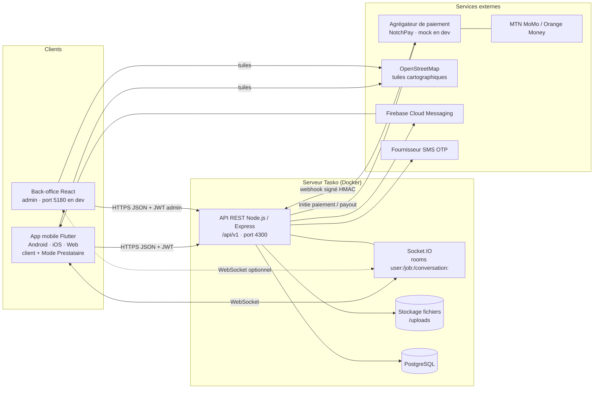

Principes :
- **Une seule API** pour l'app et l'admin ; l'admin est un client privilégié (rôle `is_admin`).
- **API sans état** (JWT) → réplicable ; l'état temps réel transite par Socket.IO (adaptateur Redis à l'échelle).
- **Paiement découplé** : un adaptateur `PaymentProvider` avec quatre implémentations (`mock`, `notchpay`, `campay`, `monetbil`), sélectionnée par le paramètre `payment_provider` (encaissements) et `payout_provider` (versements, `same` par défaut) ; chaque transaction garde son fournisseur.
- **Catalogue piloté par les données** : catégories, tarifs, villes et paramètres en base, jamais dans le code client.

---

## 2. Composants

| Composant | Technologie | Responsabilités |
|---|---|---|
| **App mobile** | Flutter (Dart) | Parcours client et prestataire, carte (`flutter_map` + OSM), géolocalisation, Socket.IO client, cache local, FR/EN |
| **Back-office** | React (Vite) | Tableau de bord, CRUD catégories/villes/promotions, utilisateurs, missions, transactions, litiges, avis, paramètres |
| **API** | Node.js / Express | Authentification JWT, OTP, règles métier, machine à états, tarification, matching, paiement, webhooks, statistiques |
| **Temps réel** | Socket.IO (même processus que l'API) | Diffusion des nouvelles demandes, statuts, positions, messages, notifications |
| **Base de données** | PostgreSQL | Données transactionnelles ; index géographiques (calcul de distance Haversine, PostGIS envisageable) |
| **Fichiers** | Disque local `/uploads` (dev) → stockage objet compatible S3 (prod) | Avatars, portfolio, photos de missions, pièces KYC (chiffrées) |
| **Paiement** | NotchPay (alternatives : Campay, Monetbil) | Encaissement Mobile Money, notification webhook, versements |
| **Notifications** | FCM + notifications en base | Push hors application, centre de notifications |
| **SMS** | Fournisseur SMS | Codes OTP |

---

## 3. Flux de paiement en séquestre

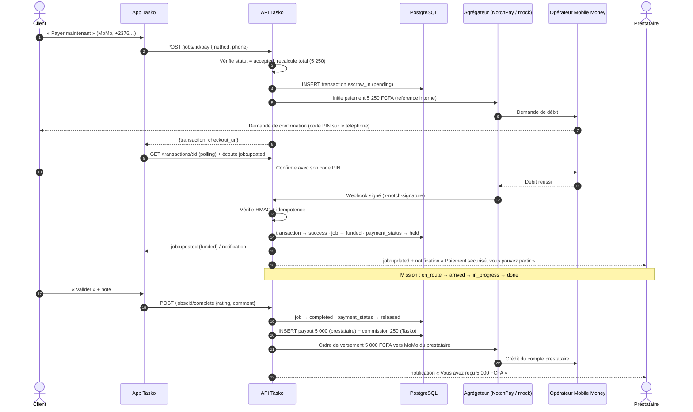

Variantes :
- **Échec** (refus, solde insuffisant ; en `mock`, numéro finissant par `000`) : transaction `failed`, mission reste `accepted`, erreur `PAYMENT_FAILED`.
- **Annulation client** en `funded`/`en_route` : transaction `refund`, `payment_status = refunded`, mission `cancelled`.
- **Litige** : fonds maintenus en `held` jusqu'à `POST /admin/disputes/:id/resolve` (`release` ou `refund`).

> ⚠️ En production, les fonds en séquestre doivent être détenus **par le partenaire agréé** (agrégateur / établissement de paiement / banque), Tasko n'enregistrant que l'état logique (`held`). Voir [02 — Risques](02-modele-economique.md#9-risques-et-conditions-de-succès).

---

## 4. Machine à états d'une mission

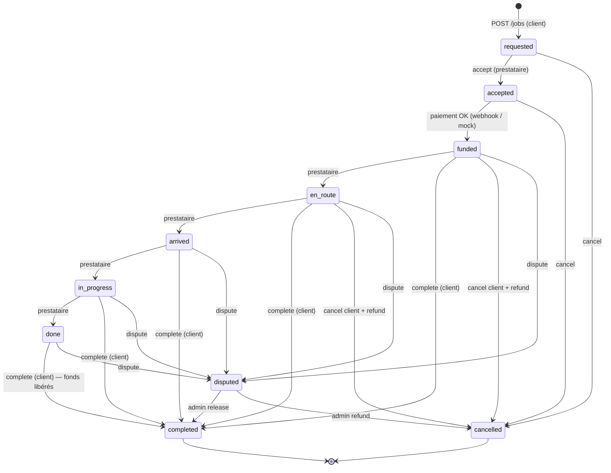

| Statut | `payment_status` typique | Signification |
|---|---|---|
| `requested` | `unpaid` | Demande créée (diffusée si pas de prestataire, sinon directe) |
| `accepted` | `unpaid` / `pending` | Prestataire trouvé ; en attente de paiement |
| `funded` | `held` | Fonds en séquestre ; le prestataire peut partir |
| `en_route` / `arrived` / `in_progress` / `done` | `held` | Exécution de la mission |
| `completed` | `released` | Validée ; prestataire payé, commission encaissée |
| `cancelled` | `unpaid` ou `refunded` | Annulée (remboursée si elle avait été payée) |
| `disputed` | `held` | Litige en cours d'arbitrage |

---

## 5. Modèle de données

### 5.1 Diagramme entité-association

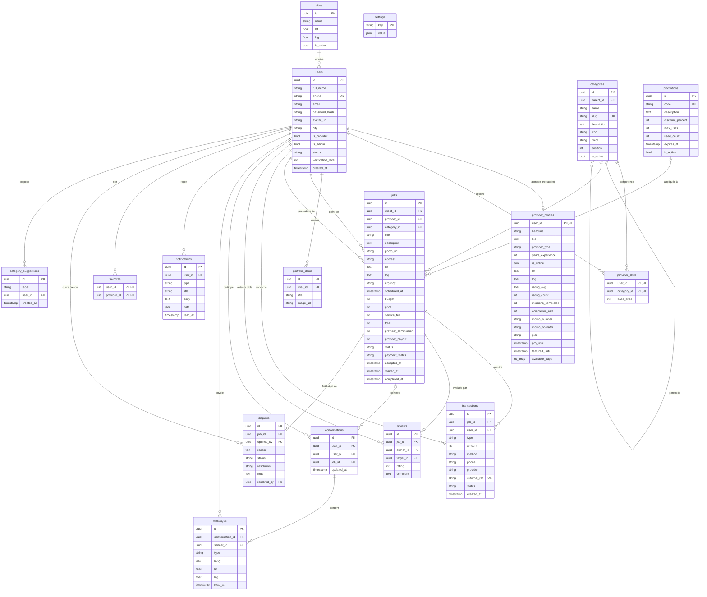

### 5.2 Description des tables

| Table | Rôle | Points clés |
|---|---|---|
| `users` | Tout compte (client, prestataire, admin) | Téléphone unique normalisé `+237…` ; `status` `active`/`suspended` ; `verification_level` 1–5 ; `is_provider` vrai dès l'activation du mode prestataire |
| `provider_profiles` | Extension 1–1 de `users` pour le Mode Prestataire | Position (`lat`, `lng`), en ligne, agrégats de réputation (dénormalisés pour la recherche), MoMo, `plan`/`pro_until`, `featured_until`, jours de disponibilité |
| `categories` | Catalogue dynamique à 2 niveaux | `parent_id` nul = catégorie, sinon sous-service ; icône parmi la liste autorisée ; `position` pour l'ordre ; désactivation plutôt que suppression |
| `provider_skills` | Compétences d'un prestataire (N–N avec `categories`) | `base_price` par compétence → `min_price` des cartes de recherche |
| `portfolio_items` | Réalisations du prestataire | Image + titre |
| `jobs` | Missions | Montants **figés** à l'acceptation (prix, frais, commission, total, versement) ; `status` + `payment_status` ; horodatages de chaque étape |
| `transactions` | Journal financier immuable | Types `escrow_in`, `payout`, `commission`, `refund`, `subscription`, `boost` ; `external_ref` unique (idempotence des webhooks) |
| `reviews` | Notes croisées | Unicité (`job_id`, `author_id`) ; `target_id` = personne notée |
| `conversations` | Fil de discussion entre deux utilisateurs | Réutilisée si elle existe ; optionnellement liée à une mission |
| `messages` | Messages | `text`, `location` (lat/lng), `image` (URL dans `body`) ; `read_at` |
| `notifications` | Centre de notifications | `type` `job`/`payment`/`message`/`system` ; `data` JSON (ex. `job_id`) |
| `favorites` | Prestataires suivis | Clé composite |
| `disputes` | Litiges | `status` `open`/`resolved` ; `resolution` `release`/`refund` ; note de l'admin |
| `settings` | Paramètres plateforme clé/valeur | `client_fee_rate`, `provider_commission_rate`, `min_service_fee`, `search_radius_km`, `avg_speed_kmh`, `pro_plan_price`, `boost_day_price`, `boost_month_price`, `payment_provider`, `otp_dev_mode`… |
| `cities` | Villes ouvertes | Coordonnées par défaut (Yaoundé 3.8480, 11.5021 · Douala 4.0511, 9.7679) ; activation progressive |
| `promotions` | Codes promo | Pourcentage, plafond d'utilisation, expiration |
| `category_suggestions` | Saisies « Autre service » | Agrégées par libellé (nombre, dernière date) pour l'admin |

Tables techniques complémentaires (selon implémentation) : `otp_codes` (code haché, expiration, tentatives), `push_tokens`, `admin_audit_log`.

Index recommandés : `users(phone)`, `provider_profiles(is_online, lat, lng)`, `provider_skills(category_id)`, `jobs(status, created_at)`, `jobs(client_id)`, `jobs(provider_id)`, `transactions(external_ref)`, `messages(conversation_id, created_at)`, `notifications(user_id, read_at)`.

---

## 6. Algorithme de matching

### 6.1 Formule actuelle (contrat d'API)

```
score = 0,35 × (1 − d / rayon)            proximité
      + 0,25 × (note / 5)                 qualité perçue
      + 0,15 × min(missions / 50, 1)      expérience prouvée
      + 0,10 × en_ligne                   disponibilité immédiate (0 ou 1)
      + 0,10 × mis_en_avant               boost actif (0 ou 1)
      + 0,05 × pro                        abonnement Pro (0 ou 1)

eta_min   = ceil(d / vitesse_moyenne × 60) + 2      (vitesse_moyenne = 20 km/h par défaut)
min_price = plus petit base_price des compétences correspondant à la recherche
```

Pipeline :

```
Requête (lat, lng, catégorie, q)
  │
  ├─▶ 1. Filtre dur : compte actif, mode prestataire, compétence ∈ catégorie (ou sous-services)
  ├─▶ 2. Distance Haversine ≤ rayon (10 km par défaut)
  ├─▶ 3. Calcul du score (0–1) et de l'ETA
  └─▶ 4. Tri (score | distance | note | prix) → ProviderCard[]
```

Exemple : prestataire à 2,3 km (rayon 10), note 4,8, 57 missions, en ligne, non boosté, Pro → `0,35×0,77 + 0,25×0,96 + 0,15×1 + 0,10 + 0 + 0,05 ≈ 0,81`.

> La mise en avant et l'abonnement Pro pèsent volontairement **peu** (15 % au total) : on achète de la visibilité, pas la première place face à un prestataire bien plus proche et mieux noté. C'est une condition de confiance.

### 6.2 Évolution prévue

Ajout progressif de : prix relatif (vs médiane de la catégorie), disponibilité déclarée (jour/heure), taux d'acceptation et délai de réponse, taux d'annulation, historique client-prestataire (favori, déjà travaillé ensemble), puis remplacement des poids manuels par un modèle appris (*learning to rank*) entraîné sur les conversions réelles.

---

## 7. Stratégie temps réel

| Besoin | Mécanisme | Room / événement |
|---|---|---|
| Nouvelle demande diffusée | Serveur → prestataires en ligne, proches, compétents | `user:<id>` → `job:new` |
| Changement de statut | Serveur → client, prestataire, room de la mission | `job:<id>` → `job:updated` |
| Position du prestataire | Prestataire → serveur (`location:update`) → rooms de ses missions actives | `provider:location` (lat, lng, eta_min, distance_km) |
| Chat | Serveur → membres de la conversation | `conversation:<id>` → `message:new`, `typing` |
| Notifications | Serveur → utilisateur | `user:<id>` → `notification:new` |

Choix techniques :
- **Authentification** à la connexion (`auth: { token }`) ; adhésion aux rooms `job:` et `conversation:` contrôlée (seuls les participants).
- **Économie de données** : position envoyée toutes les 5–15 s seulement en mission active, et uniquement si déplacement significatif (> 20–30 m).
- **Résilience** : à la reconnexion, l'app recharge l'état par REST (`GET /jobs/:id`) — le temps réel accélère, le REST fait foi.
- **Mise à l'échelle** : adaptateur Redis pour Socket.IO et *sticky sessions* derrière le répartiteur de charge.
- **Repli** : push FCM quand l'app est en arrière-plan.

---

## 8. Sécurité

| Couche | Mesures |
|---|---|
| Identité | OTP SMS (limité en tentatives, code haché, expiration courte), mots de passe hachés (bcrypt/argon2), JWT signé 30 j |
| Autorisation | RBAC (client / prestataire / admin) + contrôle d'appartenance sur chaque ressource (mission, conversation, transaction) |
| API | Validation des entrées (schémas), requêtes SQL paramétrées, Helmet, CORS restreint aux origines connues, limitation de débit (auth, OTP, paiement) |
| Paiement | Montants calculés côté serveur, signature HMAC des webhooks, idempotence par `external_ref`, journal immuable des transactions, rapprochement quotidien avec l'agrégateur |
| Fichiers | Types MIME et tailles contrôlés, noms aléatoires, pièces KYC chiffrées et hors du répertoire public |
| Données personnelles | Minimisation, masquage des numéros dans les journaux, consentement, suppression de compte, durée de conservation |
| Exploitation | Secrets en variables d'environnement, HTTPS, sauvegardes chiffrées, mises à jour de dépendances, journalisation centralisée, alertes |
| Anti-fraude | Détection de comptes multiples (même téléphone/appareil), schémas de notation suspects, annulations répétées, litiges en série |

---

## 9. Déploiement

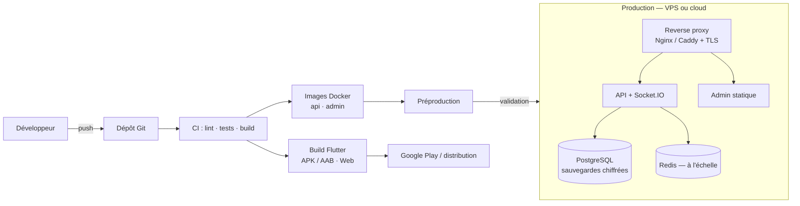

| Étape | Choix |
|---|---|
| **Développement local** | `docker compose up -d` (PostgreSQL), API sur le port 4300, admin sur 5180, Flutter sur Chrome ou émulateur |
| **Hébergement MVP** | 1 VPS (2–4 vCPU, 4–8 Go RAM) avec Docker Compose ; datacenter le plus proche possible des utilisateurs (Europe ou Afrique) pour limiter la latence |
| **Montée en charge** | Base managée, plusieurs instances API, Redis, stockage objet, CDN pour les images |
| **CI/CD** | Pipeline (ex. GitHub Actions) : lint, tests unitaires (tarification, machine à états), tests d'API, build des images, déploiement sur préproduction puis production après validation |
| **Observabilité** | Journaux centralisés, métriques (latence, erreurs, jobs/minute, paiements en attente), alertes sur échec de webhook |
| **Sauvegardes** | Dump quotidien + rétention 30 jours ; test de restauration mensuel |

---

## 10. Évolution data & IA

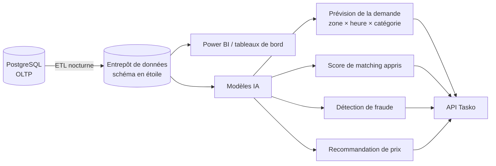

| Brique | Contenu | Usage |
|---|---|---|
| **Entrepôt de données** | Faits : missions, transactions, recherches (y compris sans résultat), connexions prestataires ; dimensions : temps, zone (maillage géographique), catégorie, prestataire, client | Analyse historique sans charger la base de production |
| **BI (Power BI)** | GMV, take rate, cohortes de rétention, taux de complétion, temps de mise en relation, carte de chaleur offre/demande | Pilotage, présentation aux investisseurs, mémoire de Master |
| **Prévision de la demande** | Séries temporelles par zone/heure/catégorie (saisonnalité hebdomadaire, jours de paie, rentrée, fêtes) | Alerter les prestataires (« forte demande en coiffure à Bastos samedi ») et ajuster le recrutement |
| **Matching appris** | Score = f(distance, disponibilité, note, expérience, prix, historique) entraîné sur les acceptations et validations | Meilleure conversion, moins d'annulations |
| **Détection de fraude** | Anomalies : paiements, comptes liés, faux avis, contournement | Réduction des pertes et protection de la confiance |

Prérequis : collecte d'événements dès le MVP (recherches, vues de profil, demandes non satisfaites), anonymisation pour l'analyse, et volume de données suffisant — l'IA est une **étape V2+**, pas une promesse du MVP.

---

## 11. V2 — Garantie de paiement, jalons, appels d'offres, planificateur et grand livre

> Spécification de référence : [contrat d'API § 5](05-contrat-api.md). Explications en langage simple : [08 — Confiance, paiement et trésorerie](08-confiance-paiement-et-tresorerie.md).

### 11.1 Composants ajoutés

| Composant | Rôle |
|---|---|
| **Planificateur serveur** (tâche périodique dans le processus API, toutes les minutes ; verrou consultatif PostgreSQL pour qu'une seule instance l'exécute) | (1) **libération automatique** des jobs et jalons dont `auto_release_at` est échu sans litige ouvert ; (2) **rappels** au client à mi-parcours et 2 h avant l'échéance ; (3) **missions récurrentes** : création d'une mission `direct` à `next_run_at` puis avance de l'échéance ; (4) **clôture des appels d'offres** à `bid_deadline` ; (5) **reversement automatique** des revenus (`auto_settlement`) ; (6) relance des versements prestataires en échec. |
| **Service de grand livre** | Calcule à partir des transactions les postes `escrow_held`, `providers_available`, `revenue_*` ; contrôle sous verrou chaque retrait admin. |
| **Service de chiffrement** | AES-256-GCM (clé `DATA_ENCRYPTION_KEY`) pour les numéros de comptes de reversement ; seules des valeurs masquées sortent de l'API. |
| **Journal d'audit** | Enregistre acteur, action, cible, détails, IP pour toute action sensible (retraits, comptes de reversement, litiges, paramètres, droits). |
| **Masquage des contacts** | Filtre de sérialisation (`phone = null` tant que `funds_secured = false`) et filtre des messages du chat (numéros remplacés par « 6•• •• •• •• »). |

Toutes les tâches du planificateur sont **idempotentes** (RG-G9) : chaque opération financière est exécutée dans une transaction SQL avec `SELECT … FOR UPDATE` sur le job ou le jalon, et des contraintes d'unicité (cible job/jalon + `type` pour `payout`, `commission`, `refund`) empêchent tout double versement, même si deux exécutions se chevauchent ou si un webhook arrive deux fois.

### 11.2 Séquence V2 : code de démarrage et libération automatique

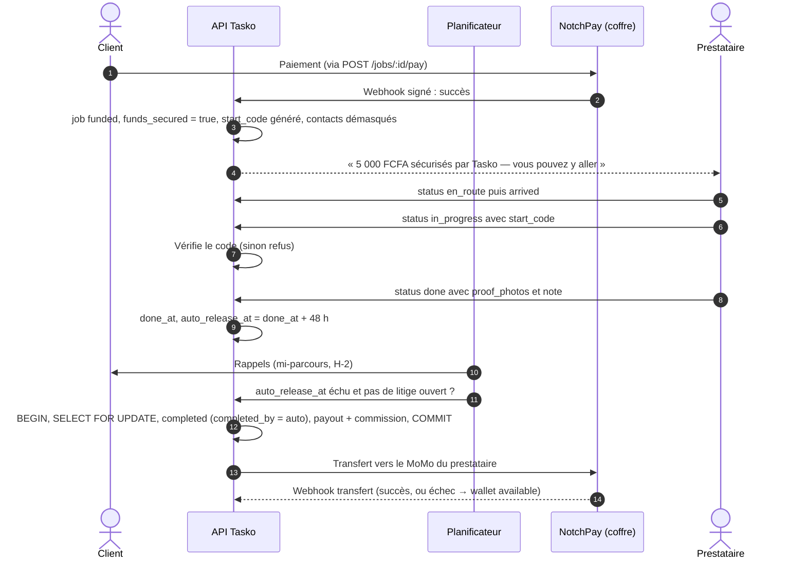

### 11.3 Machine à états V2 d'une mission

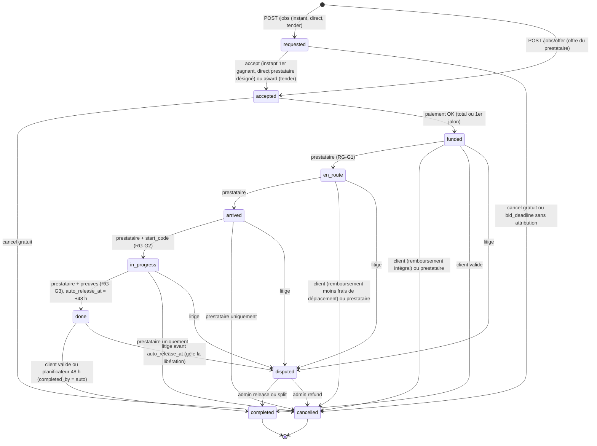

Notes :
- **Pas d'annulation client** à partir de `arrived` : seule la voie du litige reste ouverte. Une annulation par le prestataire rembourse toujours intégralement le client et incrémente son compteur `cancellations`.
- Le client peut toujours valider plus tôt (`funded`…`done` → `completed`), comme en V1.
- `split` : le job est `completed`, `provider_amount` est versé au prestataire, le reste est remboursé au client (`partial_refund`).
- Avec des **jalons**, le statut du job est dérivé : `funded` dès le 1er jalon financé, `done` quand le dernier jalon est `submitted`, `completed` quand tous sont `released`.

### 11.4 Machine à états d'un jalon

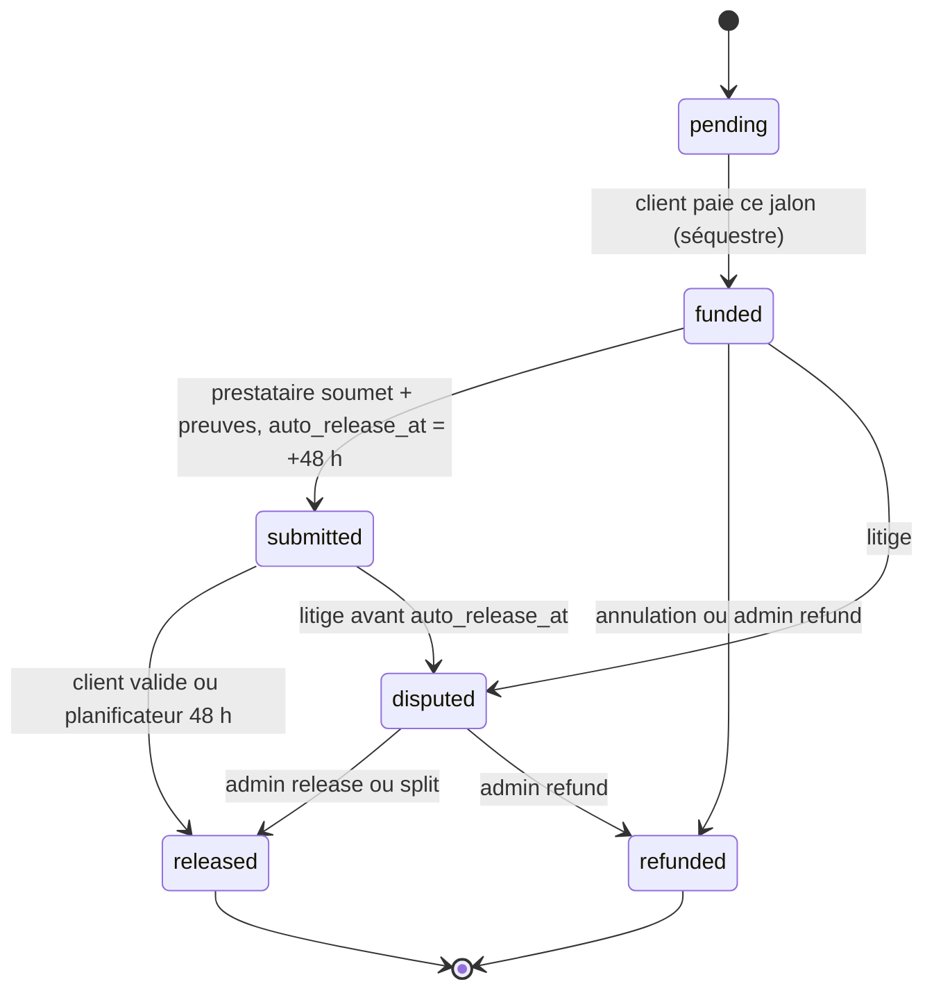

### 11.5 Modèle de données — tables et colonnes ajoutées

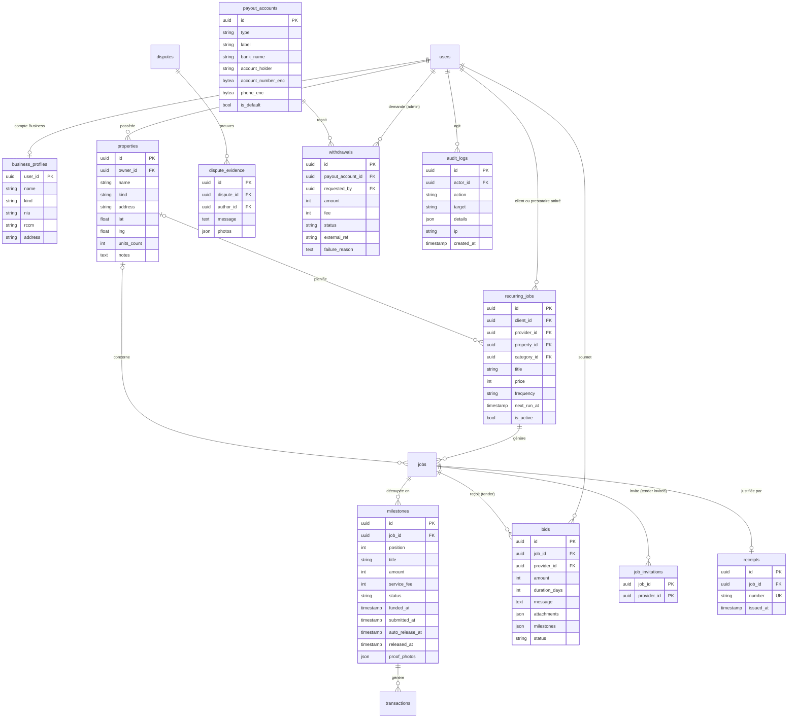

| Table / colonne | Points clés |
|---|---|
| `users.account_type`, `business_profiles` | `individual` / `business` ; type `company`, `real_estate`, `ngo`, `administration`, `other` ; NIU, RCCM pour les reçus. |
| `provider_profiles.public_code`, `cancellations`, `wallet_available` | Code `TSK-XXXXX` unique (recherche directe) ; compteur d'annulations (score) ; disponible du portefeuille. |
| `jobs` (colonnes V2) | `mode`, `origin`, `visibility`, `bid_deadline`, `budget_min/max`, `funds_secured`, `funded_at`, `start_code` (renvoyé uniquement au client), `done_at`, `auto_release_at`, `completed_by`, `completion_proof`, `cancellation_fee`, `cancel_reason`, `cancelled_by`, `property_id`, `recurring_job_id`. Index `jobs(status, auto_release_at)` pour le planificateur. |
| `milestones` | Somme des `amount` = `jobs.price` ; index `(status, auto_release_at)`. |
| `bids` | Unicité `(job_id, provider_id)` ; statuts `pending/accepted/rejected/withdrawn`. |
| `job_invitations` | Prestataires invités d'un appel d'offres `invited`. |
| `disputes` (colonnes V2) | `milestone_id`, `respond_before`, `resolution` `release/refund/split`, `provider_amount`. |
| `reviews` | Désormais aussi **prestataire → client** (alimente `client.trust`). |
| `transactions` (types V2) | + `cancellation_fee`, `partial_refund`, `withdrawal` (prestataire), `revenue_withdrawal` (admin) ; colonne `milestone_id` ; unicité (cible + type) pour `payout`, `commission`, `refund`. |
| `receipts` | Numéro séquentiel par année `TSK-2026-000123`. |
| `payout_accounts` | Numéros **chiffrés** ; seules des versions masquées sont exposées. |
| `withdrawals` | Retraits admin ; `pending → success/failed`. |
| `audit_logs` | Remplace `admin_audit_log` ; en ajout seul (jamais modifié). |
| `settings` (clés V2) | `auto_release_hours`, `require_start_code`, `require_completion_proof`, `cancellation_fee_en_route`, `dispute_response_hours`, `mask_contacts_until_funded`, `tender_default_days`, `max_bids_per_tender`, `auto_payout`, `auto_settlement`, `auto_settlement_min`. |

### 11.6 Grand livre et trésorerie

Le coffre physique est **le compte marchand Tasko chez l'agrégateur** ; la base ne détient pas d'argent, elle **tient les comptes**. Chaque poste est calculé à partir des transactions réussies :

| Poste | Calcul (simplifié) | Appartient à |
|---|---|---|
| `escrow_held` | `escrow_in` des jobs/jalons non libérés − remboursements correspondants | Clients / prestataires — intouchable |
| `providers_available` | Montants libérés non encore versés ou en échec (+ `cancellation_fee` dus) − retraits prestataires | Prestataires — intouchable |
| `revenue_total` | Frais de service + commissions + abonnements + boosts + frais d'annulation conservés − remises | Tasko |
| `revenue_withdrawn` | `revenue_withdrawal` réussis | — |
| `revenue_available` | `revenue_total − revenue_withdrawn − retraits en cours` | **Seul poste retirable** |

Contrôles :
- **Retrait admin** : transaction SQL, verrou, recalcul de `revenue_available`, refus `409` si dépassement, mot de passe re-saisi (`401` sinon), entrée d'audit, puis ordre de transfert à l'agrégateur ; en cas d'échec, le montant redevient disponible.
- **Rapprochement** : `aggregator_balance` (si l'API de l'agrégateur l'expose) doit couvrir `escrow_held + providers_available + revenue_available` ; tout écart déclenche une alerte.

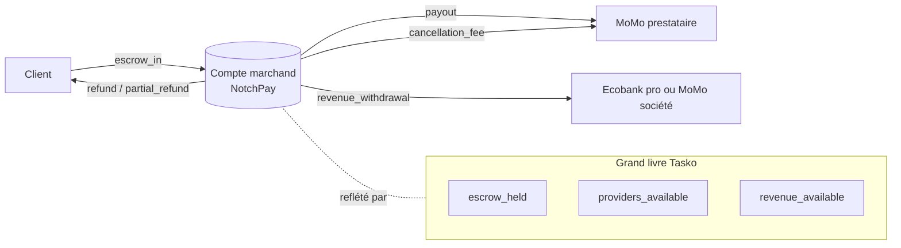
