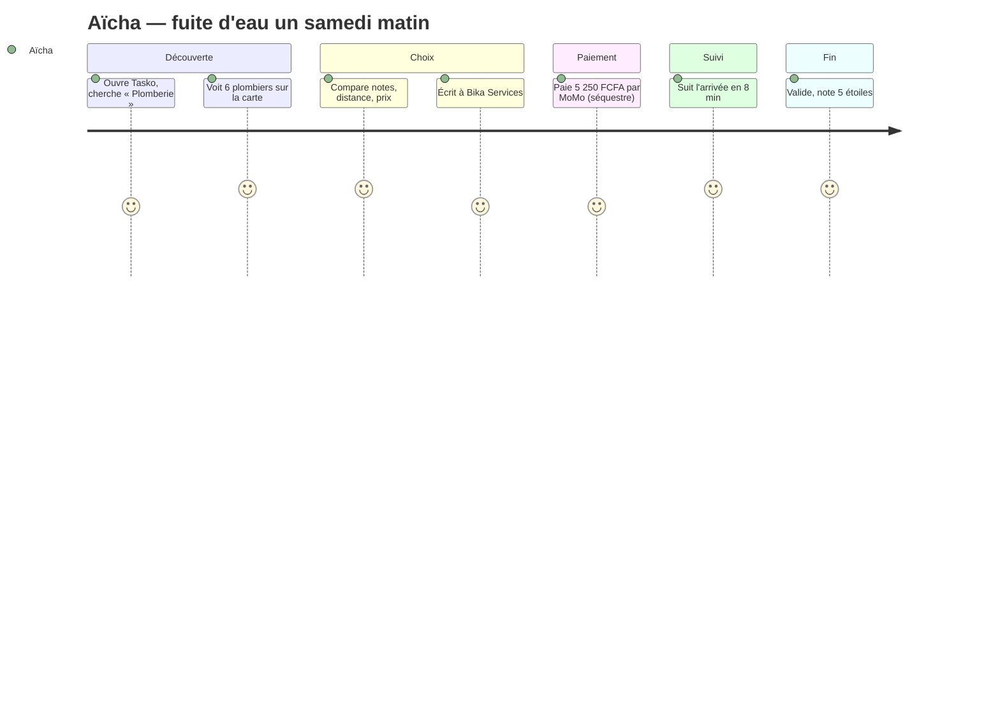
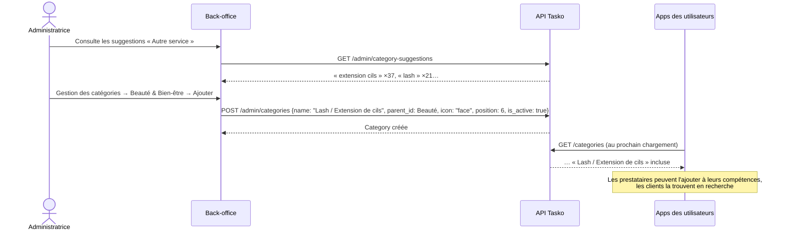

# Tasko — Parcours utilisateurs

> Les numéros d'écran renvoient à la planche de maquette ci-dessus (la planche comporte deux vignettes « 8 », désignées ici **8a — Suivi en temps réel** et **8b — Job terminé**). Les personnages sont fictifs ; les montants illustrent la tarification par défaut (frais de service client 5 %, commission prestataire 0 %).

---

## Sommaire

1. [Client — urgence plomberie (Aïcha, Yaoundé)](#1-client--urgence-plomberie)
2. [Étudiant prestataire (Moussa, Yaoundé)](#2-étudiant-prestataire)
3. [Tresseuse (Mireille, Douala)](#3-tresseuse)
4. [Entreprise — B2B (une agence immobilière, Douala)](#4-entreprise--b2b)
5. [Administrateur — ajouter « Lash / Extension de cils » sans toucher au code](#5-administrateur--ajouter-une-catégorie)
6. [Administrateur — résoudre un litige](#6-administrateur--résoudre-un-litige)
7. [V2 — Accord déjà conclu hors de l'app (Bika et Aïcha)](#7-v2--accord-déjà-conclu-hors-de-lapp)
8. [V2 — Appel d'offres d'une entreprise avec jalons](#8-v2--appel-doffres-dune-entreprise-avec-jalons)
9. [V2 — Propriétaire immobilier avec ménage hebdomadaire](#9-v2--propriétaire-immobilier-avec-ménage-hebdomadaire)
10. [V2 — L'administrateur retire ses revenus vers Ecobank](#10-v2--ladministrateur-retire-ses-revenus-vers-ecobank)
11. [V2 — Prestataire absent et médiation à trois](#11-v2--prestataire-absent-et-médiation-à-trois)

> **V2** : les parcours 7 à 10 illustrent la garantie de paiement, les modes de mission et la trésorerie décrits dans [08 — Confiance, paiement et trésorerie](08-confiance-paiement-et-tresorerie.md). Dans les parcours 1 à 6, la V2 ajoute partout le **code de démarrage**, les **photos de fin** et la **libération automatique après 48 h** ; et une annulation pendant « En route » coûte au client 1 000 FCFA de frais de déplacement versés au prestataire.

---

## 1. Client — urgence plomberie

**Persona** : Aïcha, 34 ans, cadre à Bastos (Yaoundé). Samedi 7 h 45 : un tuyau fuit sous l'évier, l'eau coule dans la cuisine. Elle ne connaît aucun plombier dans le quartier.

| # | Étape | Ce qui se passe | Écran |
|---|---|---|---|
| 1 | Ouverture | Aïcha est déjà inscrite (OTP vérifié, niveau 2). L'accueil affiche sa ville et les catégories. | 3 · Accueil |
| 2 | Recherche | Elle tape « Plomberie ». Tasko affiche les plombiers **en ligne** dans un rayon de 10 km, triés par score. | 4 · Carte des prestataires |
| 3 | Comparaison | « Bika Services — Plombier — 2,3 km — ★ 4,8 (23 avis) — à partir de 5 000 FCFA ». Elle ouvre la fiche : 5 ans d'expérience, avis récents, badge identité vérifiée. | 5 · Détail d'un service · 9 · Profil prestataire |
| 4 | Contact | Elle écrit : « Fuite d'eau sous l'évier, pouvez-vous venir ? ». Réponse en 1 minute : « Disponible dans 20 min », avec partage de position. | 6 · Chat |
| 5 | Demande | Elle envoie une demande directe (urgence « maintenant », photo de la fuite, adresse). Bika accepte au prix de 5 000 FCFA. | 14 · Notifications |
| 6 | Paiement | Récapitulatif : 5 000 FCFA + frais de service 5 % = **5 250 FCFA**. Elle choisit MTN MoMo, confirme avec son code PIN. Message : « Votre paiement est sécurisé et sera débloqué après la validation du job ». | 7 · Paiement sécurisé |
| 7 | Suivi | La mission passe « En route » ; Aïcha voit Bika se déplacer, **arrivée estimée 8 min**. Bouton « Appeler » au besoin. | 8a · Suivi en temps réel |
| 8 | Intervention | « Sur place » → « Mission » → « Terminé ». | 8a |
| 9 | Validation | Aïcha vérifie : plus de fuite. Elle note ★★★★★ « Très professionnel et rapide ». Les 5 000 FCFA sont versés à Bika ; Tasko conserve 250 FCFA. | 8b · Job terminé |
| 10 | Fidélisation | Elle ajoute Bika à ses favoris (« Suivre ») pour la prochaine fois. | 9 · Profil prestataire |

**Ce que le parcours démontre** : rapidité (≈ 30 min du besoin à l'arrivée), confiance (avis, vérification, séquestre), transparence (prix et frais affichés avant paiement).

**Si ça se passe mal** : Bika ne part pas → Aïcha annule tant que la mission est `funded` → remboursement intégral automatique (V2 : si Bika s'est déclaré « En route » mais ne bouge pas, Aïcha ouvre plutôt un litige — le suivi GPS le prouve — pour être remboursée intégralement sans frais de déplacement). Travail bâclé → elle ouvre un litige au lieu de valider (voir [§ 6](#6-administrateur--résoudre-un-litige)).

---

## 2. Étudiant prestataire

**Persona** : Moussa Kamga, 22 ans, étudiant en Licence d'informatique à l'Université de Yaoundé I. Il maîtrise Word/Excel, Canva/Photoshop et le montage vidéo. Il cherche un revenu compatible avec ses cours.

| # | Étape | Ce qui se passe | Écran |
|---|---|---|---|
| 1 | Découverte | Un ambassadeur Tasko présente l'application sur le campus. Moussa s'inscrit (OTP). | 1 · Démarrage · 2 · Onboarding |
| 2 | Mode Prestataire | Dans le menu, il active le **Mode Prestataire** : titre « Étudiant / Informaticien », type `student`, numéro MoMo. | 15 · Menu utilisateur |
| 3 | Compétences | Il coche plusieurs sous-services et fixe ses prix de départ : *Dépannage informatique* 3 000 FCFA, *Saisie de documents* 2 000 FCFA, *Design graphique* 5 000 FCFA, *Montage vidéo* 10 000 FCFA. | 10 · Profil prestataire étudiant / débrouillard |
| 4 | Disponibilités | Il indique ses jours : lundi à samedi après les cours (le dimanche est désactivé). | 10 |
| 5 | Portfolio | Il ajoute 3 réalisations : une affiche, un CV, un extrait de montage. | 10 · « Mes réalisations » |
| 6 | Première mission | Il passe « en ligne ». Notification : « Nouveau job disponible — Saisie d'un mémoire, 2,1 km ». Il accepte à 8 000 FCFA (40 pages). | 14 · Notifications |
| 7 | Exécution | La cliente paie (8 000 + 400 = 8 400 FCFA, en séquestre). Moussa échange les fichiers via le chat, livre, passe la mission en « Terminé ». | 6 · Chat |
| 8 | Paiement | La cliente valide et note 5★. Moussa reçoit **8 000 FCFA** sur son MoMo. | 15 · Mes paiements |
| 9 | Progression | Après 12 missions (★ 4,7), il passe au niveau « Compétence vérifiée » grâce à son portfolio. Il envisage **Tasko Pro** (3 000 FCFA/mois) pour être mieux classé à la rentrée. | 10 |

**Valeur pour Moussa** : un revenu flexible, une **réputation vérifiable** qui lui servira de référence professionnelle, et la reconnaissance de compétences acquises hors diplôme.

---

## 3. Tresseuse

**Persona** : Mireille, 27 ans, tresseuse à domicile à Akwa (Douala). Elle travaille déjà, mais surtout par bouche-à-oreille et WhatsApp ; certaines clientes annulent au dernier moment après qu'elle s'est déplacée.

| # | Étape | Ce qui se passe | Écran |
|---|---|---|---|
| 1 | Recrutement | Une équipe Tasko passe dans son quartier et l'aide à créer son profil sur place (photo, OTP, MoMo Orange). | 1 · 2 |
| 2 | Profil | Type `artisan`, catégorie *Beauté & Bien-être* → *Tresses* (à partir de 5 000 FCFA), *Tissage* (8 000 FCFA), *Nattes enfants* (3 000 FCFA). Portfolio de 6 coiffures. | 9 · Profil prestataire |
| 3 | Vérification | Elle présente sa CNI : niveau 3 « Identité vérifiée » (important pour les services à domicile). | 9 (badge) |
| 4 | Demande planifiée | Une cliente réserve des *knotless braids* pour samedi 10 h (urgence « planifié »), à 12 000 FCFA. | 14 · Notifications |
| 5 | Garantie | La cliente paie **12 600 FCFA** (dont 600 FCFA de frais) dès l'acceptation. Mireille sait que l'argent est bloqué : **plus de déplacement pour rien**. | 7 · Paiement sécurisé |
| 6 | Jour J | Mireille passe « En route » ; la cliente suit son arrivée. | 8a · Suivi |
| 7 | Fin | Validation, note 5★, avis avec photo. Mireille reçoit 12 000 FCFA. | 8b · Job terminé |
| 8 | Croissance | Un samedi de forte demande, elle achète un **boost d'une journée (500 FCFA)** pour apparaître en tête dans sa zone. | 15 · Menu (Mode Prestataire) |

**Valeur pour Mireille** : des clientes au-delà de son cercle, la fin des annulations sans compensation, une vitrine professionnelle.

---

## 4. Entreprise — B2B

**Persona** : une agence immobilière fictive de Douala gère une soixantaine d'appartements meublés. Elle a besoin de ménages entre deux locations, de petites réparations (plomberie, électricité, climatisation) et, ponctuellement, de peintres.

| # | Étape | Ce qui se passe | Écran |
|---|---|---|---|
| 1 | Création du compte | La gestionnaire crée un compte et indique l'entreprise (MVP : compte standard ; V2 : **Tasko Business**). | 1 · 2 |
| 2 | Prestataires attitrés | Elle teste plusieurs prestataires et ajoute les meilleurs en favoris (ménage, plomberie, froid). | 9 · Profil prestataire (« Suivre ») |
| 3 | Commandes récurrentes | Chaque vendredi, elle publie des demandes de ménage planifiées à 4 adresses ; ses prestataires favoris sont notifiés en priorité. | 3 · Accueil · 14 |
| 4 | Urgence | Une climatisation tombe en panne chez un locataire : demande « maintenant » diffusée aux techniciens froid proches. | 4 · Carte |
| 5 | Paiement et suivi | Paiement MoMo en séquestre (V2 : facturation mensuelle consolidée), suivi temps réel, validation après contrôle. | 7 · 8a · 8b |
| 6 | Pilotage (V2) | Tableau de bord dépenses par appartement, export des justificatifs, plusieurs utilisateurs (gestionnaires), prestataires attitrés avec tarifs négociés. | — (espace Business, V2) |

**Valeur pour l'entreprise** : un réservoir de prestataires évalués, la traçabilité des interventions et des paiements, moins de temps perdu à chercher.
**Valeur pour Tasko** : volume récurrent, panier plus élevé, abonnement Business.

---

## 5. Administrateur — ajouter une catégorie

**Contexte** : depuis un mois, la tuile « Autre service » remonte régulièrement des saisies comme « pose de cils », « extension cils », « lash ». La catégorie n'existe pas. L'administratrice, Carine, veut l'ajouter **sans développeur, sans nouvelle version de l'application**.

| # | Étape | Écran |
|---|---|---|
| 1 | Carine se connecte au back-office ; le tableau de bord montre l'activité récente. | 11 · Tableau de bord admin |
| 2 | Elle ouvre les **suggestions** « Autre service » : « extension cils » (37 saisies), « lash » (21). | 12 · Gestion des catégories |
| 3 | Elle choisit « Ajouter une catégorie » : nom **« Lash / Extension de cils »**, description « Pose et remplissage d'extensions de cils, à domicile ou en salon », catégorie parente *Beauté & Bien-être*, icône `face`, statut **Actif**, position 6. | 13 · Ajouter une catégorie |
| 4 | Elle enregistre. **Aucune ligne de code, aucune mise à jour de l'application.** | 13 |
| 5 | Au prochain chargement, la catégorie apparaît dans l'accueil et la recherche des utilisateurs ; les esthéticiennes l'ajoutent à leurs compétences avec leur prix. | 3 · Accueil · 10 |
| 6 | Les jours suivants, elle suit le nombre de prestataires inscrits et de jobs sur la nouvelle catégorie dans les statistiques. | 11 |

---

## 6. Administrateur — résoudre un litige

**Contexte** : un client a payé 15 000 FCFA (+ 750 FCFA de frais) pour la peinture d'une chambre. Le prestataire a passé la mission en « Terminé », mais le client ouvre un litige : « Deuxième couche non faite, traces sur le carrelage ». Les fonds sont **bloqués** (`disputed`, `payment_status = held`).

| # | Étape | Ce qui se passe | Écran |
|---|---|---|---|
| 1 | Alerte | Le tableau de bord affiche « Litiges ouverts : 1 » et l'activité « Litige ouvert ». | 11 · Tableau de bord admin |
| 2 | Instruction | Carine ouvre le litige : détail de la mission, horodatages (arrivé 9 h 10, terminé 11 h 05), photos, conversation client-prestataire. | Back-office · Litiges |
| 3 | Contradictoire | Elle contacte les deux parties (téléphone support). Le prestataire reconnaît ne pas avoir fait la seconde couche faute de peinture et accepte de revenir. | — |
| 4 | Décision | Après retour du prestataire et confirmation du client, Carine résout en **`release`** avec la note « Seconde couche réalisée le 14/10, confirmée par le client ». | Back-office · Litiges |
| 5 | Effets | Mission `completed`, versement de 15 000 FCFA au prestataire, 750 FCFA de frais conservés ; les deux parties sont notifiées. | 14 · Notifications |
| 6 | Alternative | Si le prestataire avait refusé, résolution **`refund`** : mission `cancelled`, remboursement intégral au client, impact sur le taux de complétion du prestataire. | — |

**Principes d'arbitrage** : décision motivée et tracée, écoute des deux parties, preuves (statuts horodatés, photos, chat), délai cible de résolution (ex. < 72 h), sanctions graduées en cas de récidive (avertissement, baisse de visibilité, suspension).

**V2** : l'admin peut aussi trancher en **`split`** (partage) — par exemple 10 000 FCFA au prestataire pour la première couche réalisée et le reste remboursé au client. Chaque partie dispose de 48 h pour déposer ses preuves (messages, photos) et le chat de la mission est versé automatiquement au dossier. Un client qui perd 3 litiges est signalé.

---

## 7. V2 — Accord déjà conclu hors de l'app

**Persona** : Aïcha (parcours 1) a gardé le contact de Bika Services. Elle le croise au marché et lui demande de remplacer le chauffe-eau la semaine prochaine. Ils se mettent d'accord sur **25 000 FCFA**. Aucune raison de lancer une demande à tous les plombiers du quartier.

| # | Étape | Ce qui se passe |
|---|---|---|
| 1 | Offre du prestataire | Bika ouvre Tasko → « Créer une offre pour un client » : numéro d'Aïcha, *Plomberie*, « Remplacement chauffe-eau », **25 000 FCFA**, jeudi 9 h. La mission est créée en mode **direct** (`origin = provider_offer`), directement au statut `accepted`. **Elle n'est diffusée à personne d'autre.** |
| 1 bis | Variante | Aïcha aurait aussi pu créer elle-même la mission en mode **direct**, en saisissant le **code Tasko** de Bika (`TSK-7F3K9`) ou son numéro. |
| 2 | Confirmation | Aïcha reçoit : « Bika Services vous propose : Remplacement chauffe-eau — 25 000 FCFA — **Payer pour confirmer** ». Elle paie 26 250 FCFA (frais 5 %). |
| 3 | Garantie | Bika voit « 25 000 FCFA sécurisés par Tasko — vous pouvez y aller ». Aïcha voit son **code de démarrage** : 5902. |
| 4 | Jour J | Bika arrive, Aïcha lui donne 5902, il démarre ; il termine avec 2 photos du chauffe-eau installé. |
| 5 | Paiement | Aïcha valide le soir même ; Bika reçoit 25 000 FCFA. Un **reçu** est disponible pour Aïcha. La mission compte dans la note et les missions réalisées de Bika. |

**Pourquoi passer par Tasko alors qu'ils étaient déjà d'accord ?** Bika est **sûr d'être payé** (l'argent était bloqué avant qu'il achète la pièce et se déplace) ; Aïcha a un **recours** et un **reçu** ; Bika fait **monter sa réputation**. Coût : 1 250 FCFA de frais pour Aïcha.

---

## 8. V2 — Appel d'offres d'une entreprise avec jalons

**Persona** : une PME fictive de Douala veut rénover son bureau (peinture, faux plafond, électricité). Budget indicatif : 400 000 à 500 000 FCFA. Elle veut **comparer plusieurs devis** et **ne pas tout payer d'avance**.

| # | Étape | Ce qui se passe |
|---|---|---|
| 1 | Compte Business | La gestionnaire active le compte **Business** : raison sociale, NIU, RCCM, adresse (ils apparaîtront sur les reçus). |
| 2 | Appel d'offres | Elle publie un **appel d'offres** (*Bâtiment & Chantier*), visibilité `public` (prestataires de la compétence à Douala), date limite dans 7 jours, budget 400 000 – 500 000 FCFA, photos des locaux. |
| 3 | Offres | 6 prestataires répondent : montant, délai, message, devis PDF et **jalons proposés**. L'un d'eux, à 450 000 FCFA en 10 jours, propose : *Gros œuvre* 200 000 · *Finitions* 250 000. Elle compare prix, délais, notes et missions réalisées. |
| 4 | Attribution | Elle **attribue** l'offre à 450 000 FCFA. Les 5 autres offres passent **automatiquement en « refusée »** et leurs auteurs sont notifiés. **Plus personne ne peut se proposer.** |
| 5 | Jalon 1 | Elle paie le jalon 1 : 200 000 + 10 000 FCFA de frais. Le prestataire voit « Jalon 1/2 : 200 000 FCFA sécurisés ». Il commence (code de démarrage), puis **soumet** le jalon avec photos. |
| 6 | Validation jalon 1 | Elle valide après visite → 200 000 FCFA versés. (Sans réponse de sa part, libération automatique 48 h après la soumission.) |
| 7 | Jalon 2 | Elle paie 250 000 + 12 500 FCFA ; finitions ; soumission ; validation → 250 000 FCFA versés. La mission est `completed`. |
| 8 | Comptabilité | Elle télécharge le **reçu** numéroté (`TSK-2026-…`) au nom de l'entreprise pour sa comptabilité. |

**Valeur** : mise en concurrence transparente, aucune avance au-delà de l'étape en cours pour l'entreprise, aucune étape non financée pour l'artisan, justificatifs comptables.

---

## 9. V2 — Propriétaire immobilier avec ménage hebdomadaire

**Persona** : M. Ngono, bailleur à Yaoundé, possède un immeuble de 6 studios meublés à Bastos et une villa à Omnisport.

| # | Étape | Ce qui se passe |
|---|---|---|
| 1 | Biens | Il enregistre ses **biens** : « Immeuble Bastos » (immeuble, 6 logements) et « Villa Omnisport » (maison). |
| 2 | Prestataire attitré | Il fait faire un premier ménage à la villa par Solange (★ 4,9), en est satisfait et la garde comme **prestataire attitrée**. |
| 3 | Récurrence | Il crée une **mission récurrente** : *Ménage* — Villa Omnisport — **hebdomadaire**, chaque samedi 8 h, 10 000 FCFA, prestataire Solange. Puis une mission **mensuelle** de *Jardinage* et une **mensuelle** de *Maintenance climatisation* pour l'immeuble avec d'autres prestataires attitrés. |
| 4 | Chaque semaine | Le planificateur crée automatiquement la mission du samedi en mode **direct** pour Solange et prévient les deux. M. Ngono paie en deux clics pour la **sécuriser** (10 500 FCFA) ; Solange voit l'argent bloqué avant de venir. |
| 5 | Exécution | Code de démarrage, photos de fin, validation (ou libération automatique 48 h après). |
| 6 | Suivi par bien | La fiche de chaque bien montre l'**historique des interventions** et le **total des dépenses** (ex. Villa Omnisport : 4 ménages + 1 jardinage ce mois = 52 500 FCFA), avec les **reçus** pour justifier les charges. |
| 7 | Imprévu | Une fuite au studio 3 : il crée une mission **instantanée** rattachée à « Immeuble Bastos » ; le premier plombier qui accepte l'obtient. |

**Valeur** : plus besoin de relancer chaque semaine, des prestataires de confiance, une vision claire du coût de chaque bien.

---

## 10. V2 — L'administrateur retire ses revenus vers Ecobank

**Contexte** : fin du mois. Carine, administratrice (et associée de la société Tasko SARL — exemple), veut transférer les revenus du mois sur le **compte Ecobank professionnel** de la société.

| # | Étape | Ce qui se passe |
|---|---|---|
| 1 | Compte de reversement | (Une seule fois) Dans **Trésorerie → Comptes de reversement**, elle a ajouté « Ecobank — Tasko SARL » (type banque, titulaire, numéro de compte — **chiffré**, affiché masqué ••••4521) et l'a marqué **par défaut**. Elle a aussi ajouté le compte MoMo de la société pour les petits retraits. |
| 2 | Lecture de la trésorerie | Elle voit : **Fonds séquestrés** 3 200 000 FCFA (missions en cours — *pas à nous*) · **Dus aux prestataires** 85 000 FCFA (*pas à nous*) · **Revenus disponibles** 742 000 FCFA, avec la ventilation (frais de service, commissions, Pro, boosts). |
| 3 | Retrait | « Retirer mes revenus » → 700 000 FCFA → compte Ecobank → elle **re-saisit son mot de passe**. |
| 4 | Contrôles | Le serveur vérifie sous verrou que 700 000 ≤ disponible (sinon refus « montant supérieur au disponible »), crée le retrait `pending`, l'inscrit au **journal d'audit** (qui, combien, vers quel compte, IP) et transmet l'ordre à l'agrégateur. |
| 5 | Résultat | Le retrait passe `success` ; le disponible tombe à 42 000 FCFA. En cas d'échec, le montant redevient disponible et le motif est affiché. |
| 6 | Automatisation (option) | Elle active le **reversement automatique hebdomadaire** vers Ecobank au-delà de 50 000 FCFA. |
| 7 | Comptabilité | Elle met de côté la **TVA** due sur les frais de service (à calculer avec l'expert-comptable) et rapproche le relevé NotchPay avec le grand livre. |

> Les fonctions de reversement vers une banque camerounaise et leurs frais sont **à vérifier auprès de NotchPay** ; si le reversement bancaire direct n'est pas disponible, la page Trésorerie s'appuie sur le circuit de règlement proposé par l'agrégateur.

---

## 11. V2 — Prestataire absent et médiation à trois

> Règles RG-G10 à RG-G15 (contrat d'API § 5.9), issues d'une **idée du porteur de projet** : l'argent déposé ne retourne jamais sur le MoMo du client par sa seule décision ; les problèmes se règlent dans un salon à trois (client, prestataire, Tasko) avant l'échéance, puis l'admin envoie l'argent à l'une des parties ou le partage. Détails : [08 § 7](08-confiance-paiement-et-tresorerie.md#7-médiation-à-trois-et-prestataire-absent-rg-g10-à-rg-g15).

**Persona** : Estelle, à Makepe (Douala), commande en urgence un électricien pour une panne de courant, 8 000 FCFA. Rodrigue accepte. Elle paie 8 400 FCFA à 9 h.

### 11.1 Cas A — le prestataire ne vient pas et ne répond pas

| # | Heure | Ce qui se passe |
|---|---|---|
| 1 | 9 h | Paiement sécurisé. L'app d'Estelle affiche : « Heure limite d'arrivée : **12 h** » (3 h pour une urgence). |
| 2 | 9 h 15 | Rodrigue passe « En route »… puis plus rien. Estelle sait qu'annuler lui coûterait 1 000 FCFA de frais de déplacement : elle attend l'heure limite. |
| 3 | 12 h | Le code de démarrage n'a pas été saisi : le bouton **« Le prestataire n'est pas venu »** apparaît. Estelle appuie, ajoute « Personne n'est venu, il ne répond pas ». |
| 4 | 12 h | Un **salon de médiation à trois** s'ouvre (Estelle, Rodrigue, médiateur Tasko). Message système : « Rodrigue a jusqu'à **minuit** pour répondre ». |
| 5 | Minuit | Aucune réponse. **Remboursement automatique intégral** d'Estelle (8 400 FCFA), sans intervention de l'admin. Rodrigue prend +1 « absence » ; au 3ᵉ incident, l'admin reçoit une alerte de suspension. |

### 11.2 Cas B — le prestataire conteste

| # | Ce qui se passe |
|---|---|
| 1 | Rodrigue répond dans le salon à 14 h : « Je suis venu à 11 h 30, le portail était fermé, j'ai appelé sans réponse. » Il joint une photo du portail. |
| 2 | Le médiateur Tasko consulte la position GPS (Rodrigue est bien resté 20 min devant l'adresse à 11 h 30) et le chat de la mission (joint en lecture). Estelle reconnaît qu'elle était sortie acheter une ampoule. |
| 3 | Le médiateur publie une **proposition** : 2 000 FCFA à Rodrigue pour le déplacement, 6 000 FCFA rendus à Estelle — ou bien Rodrigue revient à 15 h et la mission continue. |
| 4 | Les deux acceptent la proposition → elle est **exécutée automatiquement**, litige clos « par accord ». |
| 5 | *Si aucun accord* : l'admin décide **dans les 72 h** (`release` / `refund` / `split`) avec un **motif obligatoire** publié dans le salon. Au-delà de **100 000 FCFA**, un **second admin** doit confirmer la décision avant qu'elle soit exécutée. |

**Ce que le parcours démontre** : le client n'est jamais bloqué face à un prestataire qui disparaît, le prestataire honnête n'est jamais dépouillé par un simple clic, et tout se joue **en transparence**, avec des messages horodatés que personne ne peut modifier ni supprimer.
