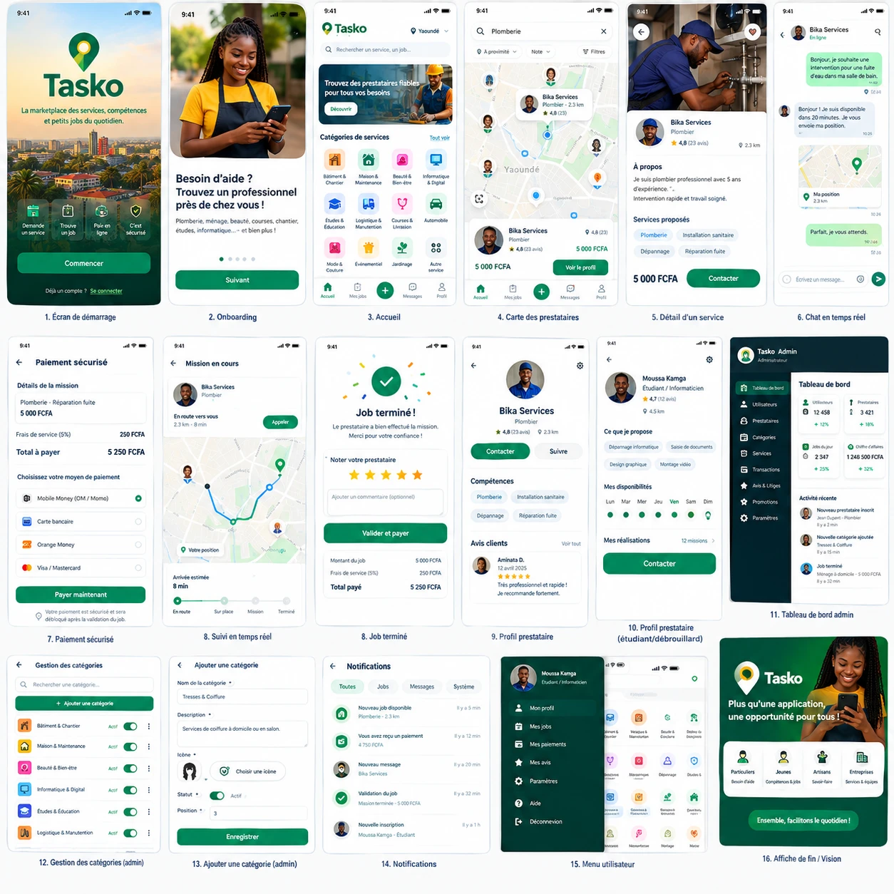

# Tasko — Roadmap et plan de lancement



> Les objectifs chiffrés ci-dessous sont des **cibles de pilotage** (à ajuster après les premières semaines réelles), pas des prévisions. Ils sont cohérents avec le scénario « médian » du [modèle économique](02-modele-economique.md#5-scénario-consolidé-sur-3-ans).

---

## Sommaire

1. [Roadmap produit](#1-roadmap-produit)
2. [Plan de lancement Yaoundé / Douala](#2-plan-de-lancement-yaoundé--douala)
3. [KPIs à suivre](#3-kpis-à-suivre)
4. [Checklist avant mise en production](#4-checklist-avant-mise-en-production)

---

## 1. Roadmap produit

```mermaid
gantt
    title Tasko — feuille de route indicative
    dateFormat  YYYY-MM-DD
    axisFormat  %b %Y
    section MVP (0–3 mois)
    API, base, contrat d'API              :done,    m1, 2026-10-01, 30d
    App Flutter client + prestataire      :active,  m2, 2026-10-15, 60d
    Back-office admin                     :active,  m3, 2026-10-15, 45d
    Paiement simulateur + intégration NotchPay :    m4, 2026-11-15, 30d
    Bêta fermée (prestataires recrutés)   :         m5, 2026-12-15, 15d
    section V1 (3–6 mois)
    Paiement réel via partenaire agréé    :         v1, 2027-01-01, 45d
    Push FCM, KYC self-service, promos    :         v2, 2027-01-15, 60d
    Lancement public Yaoundé puis Douala  :milestone, v3, 2027-02-01, 0d
    section V2 (6–12 mois)
    Garantie de paiement et trésorerie    :         b0, 2027-03-01, 60d
    Tasko Business (B2B)                  :         b1, 2027-04-01, 90d
    Matching enrichi, anti-contournement  :         b2, 2027-05-01, 90d
    Entrepôt de données + Power BI        :         b3, 2027-06-01, 60d
    section Expansion (12–36 mois)
    Bafoussam, Limbe, Kribi               :         e1, 2027-10-01, 120d
    IA : prévision demande, fraude        :         e2, 2028-01-01, 180d
    Afrique centrale (CEMAC)              :         e3, 2028-07-01, 180d
```

| Phase | Durée | Objectif | Contenu principal | Critère de passage |
|---|---|---|---|---|
| **MVP** | 0–3 mois | Prouver le parcours de bout en bout | Inscription OTP, Mode Prestataire multi-compétences, catégories dynamiques, recherche + carte + score, missions et machine à états, paiement séquestre simulé (NotchPay intégré en bac à sable), suivi temps réel, chat, notifications, notation, Pro/Boost, litiges, back-office et statistiques | Bêta : 50 missions réelles réalisées de bout en bout sans incident bloquant |
| **V1** | 3–6 mois | Lancer commercialement une ville puis deux | Paiement réel via partenaire agréé, push, KYC self-service, notation du client, validation automatique, promotions, réinitialisation de mot de passe, support structuré, application publiée sur Google Play | 100 jobs/jour à Yaoundé, taux de complétion > 80 % |
| **V2** | 6–12 mois | Augmenter panier, fréquence et marge | **Garantie de paiement** (code de démarrage, libération auto 48 h, litiges avec preuves et partage, réputation client, masquage des contacts), **modes** direct / offre du prestataire / appel d'offres, **jalons**, comptes Business, biens immobiliers, missions récurrentes, reçus, portefeuille prestataire, **trésorerie admin** (voir [08](08-confiance-paiement-et-tresorerie.md)), matching enrichi, commission prestataire progressive, frais de déplacement, services premium (urgence garantie), entrepôt de données et BI | Take rate ≥ 8 %, rétention clients M3 > 30 % |
| **Expansion** | 12–36 mois | Multiplier les villes et monter en valeur | Bafoussam, Limbe, Kribi, puis autres villes ; IA (prévision, fraude, matching appris) ; pays de la CEMAC ; partenariats financiers | Modèle de lancement de ville reproductible et rentable |

---

## 2. Plan de lancement Yaoundé / Douala

### 2.1 Principe : densité avant étendue

Une marketplace locale échoue si le client ne trouve personne. Tasko lance donc **quartier par quartier** et **catégorie par catégorie**, en construisant **l'offre avant la demande**.

```
Semaines -8 à -1        Semaines 1 à 4            Semaines 5 à 12           Mois 4+
RECRUTER L'OFFRE   ──▶  BÊTA FERMÉE          ──▶  OUVERTURE PUBLIQUE   ──▶  DOUALA puis
200 prestataires        Clients invités,          Yaoundé (5–8 quartiers)    autres villes
vérifiés, formés        50 premières missions     marketing ciblé
```

### 2.2 Zones et catégories prioritaires

| Ville | Quartiers pilotes (exemples, à confirmer par repérage) | Catégories d'amorçage |
|---|---|---|
| **Yaoundé** | Bastos, Ngousso, Omnisport, Biyem-Assi, Ngoa-Ekellé (campus), Mvog-Mbi, Essos | Plomberie, électricité, ménage, coiffure/tresses, répétiteurs, informatique |
| **Douala** | Akwa, Bonapriso, Bonamoussadi, Makepe, Logbessou, Ndokoti | Plomberie, froid/climatisation, ménage, coiffure/tresses, mécanique, événementiel |

### 2.3 Recrutement des 200 premiers prestataires (sur le terrain)

| Canal | Action | Cible indicative |
|---|---|---|
| **Campus universitaires** (Yaoundé I et II, Douala…) | Stands, ambassadeurs, ateliers « gagne de l'argent avec tes compétences » | 50 étudiants (répétition, saisie, design, montage, informatique) |
| **Marchés et quincailleries** | Partenariat avec quincailleries : les artisans qui y achètent sont présentés à Tasko | 50 artisans (plomberie, électricité, maçonnerie, peinture) |
| **Salons de coiffure et instituts** | Visites, inscription assistée, photos du portfolio sur place | 50 coiffeuses, tresseuses, manucures, esthéticiennes |
| **Chantiers** | Rencontre des chefs de chantier pour les manœuvres et ouvriers spécialisés | 30 ouvriers du bâtiment |
| **Garages, ateliers, couturiers** | Démarchage de proximité | 20 mécaniciens, couturiers, réparateurs |

Accompagnement : inscription assistée (photo, OTP, compétences, MoMo), vérification d'identité sur place (niveau 3), mini-formation (accepter une mission, statuts, chat, politesse, annulation), **kit de démarrage** (autocollant « Disponible sur Tasko », cartes à distribuer avec un code de parrainage), commission prestataire à **0 %** pendant la phase de lancement.

### 2.4 Ambassadeurs, parrainage, partenariats

| Levier | Mécanisme | Remarque |
|---|---|---|
| **Ambassadeurs étudiants** | 10–20 étudiants rémunérés à la performance (prestataire actif recruté, première mission réalisée) | Recrutement, animation des campus, contenu réseaux sociaux |
| **Parrainage client** | Code promo pour le filleul (ex. frais de service offerts sur le premier job) et crédit pour le parrain après sa première mission | Via le module `promotions` ; plafonné pour éviter les abus |
| **Parrainage prestataire** | Un prestataire qui en recrute un autre gagne un boost gratuit | Densifie l'offre par réseau de confiance |
| **Partenariats** | Quincailleries, fournisseurs de produits de beauté, agences immobilières, syndics, écoles privées, associations d'artisans, incubateurs | Canal B2B et crédibilité |
| **Communication** | WhatsApp (statuts, groupes de quartier), Facebook/TikTok (vidéos « avant/après » des prestataires), radios locales, affichage près des campus | Témoignages réels plutôt que publicité abstraite |

### 2.5 Calendrier de lancement d'une ville (modèle reproductible)

| Semaine | Action |
|---|---|
| S-8 à S-5 | Repérage des quartiers, recrutement de l'équipe terrain et des ambassadeurs, partenariats |
| S-4 à S-1 | Recrutement et vérification des prestataires, formation, création des catégories dans le back-office |
| S1 à S4 | Bêta fermée : 200–500 clients invités, support renforcé, correction rapide |
| S5 | Ouverture publique dans les quartiers pilotes, campagne de parrainage |
| S6 à S12 | Extension progressive aux quartiers voisins selon les données (demandes non satisfaites, temps de mise en relation) |

---

## 3. KPIs à suivre

| KPI | Définition | Pourquoi | Cible indicative (fin V1) |
|---|---|---|---|
| **GMV** | Somme des prix des missions `completed` | Taille de l'activité | Croissance mensuelle > 15 % |
| **Take rate** | (frais + commissions) / GMV | Capacité à monétiser | 5 % → 8–10 % en V2 |
| **Jobs / jour** | Missions `completed` par jour | Traction | 100 à Yaoundé |
| **Taux de complétion** | `completed` / missions acceptées | Qualité de l'exécution | > 80 % |
| **Taux de satisfaction des demandes** | Demandes ayant trouvé un prestataire / demandes publiées | Liquidité du marché | > 70 % |
| **Temps de mise en relation** | Délai entre demande et acceptation | Promesse « tout de suite » | Médiane < 10 min en urgence |
| **Rétention client** | % de clients qui refont un job à M1, M3 | Valeur à long terme | M3 > 30 % |
| **Rétention prestataire** | % de prestataires actifs (≥ 1 job) chaque mois | Santé de l'offre | > 60 % |
| **CAC** | Coût d'acquisition par client actif (marketing / nouveaux clients actifs) | Efficacité marketing | < 1 000 FCFA au lancement (à affiner) |
| **LTV** | Marge nette cumulée générée par un client sur sa durée de vie | Rentabilité de l'acquisition | LTV / CAC > 3 |
| **NPS** | Recommandation (−100 à +100), client et prestataire séparément | Satisfaction et bouche-à-oreille | > 40 |
| **Taux de litige** | Litiges / missions payées | Confiance | < 2 % |
| **Taux d'annulation** | Missions annulées / créées | Fiabilité | < 15 % |
| **Taux de conversion Pro** | Prestataires Pro / prestataires actifs | Revenus récurrents | 5–10 % |

Tous ces indicateurs doivent être visibles dans le **tableau de bord admin** (écran 11) puis dans l'entrepôt de données / Power BI.

---

## 4. Checklist avant mise en production

### 4.1 Paiement et juridique

- [ ] **Partenaire de paiement agréé** retenu (NotchPay ou alternative), contrat signé, frais d'encaissement et de versement connus et saisis dans le modèle économique
- [ ] Schéma de **séquestre** validé juridiquement : les fonds sont détenus par/avec un acteur agréé (réglementation COBAC/BEAC sur les services de paiement à faire vérifier par un juriste)
- [ ] Clés de production NotchPay, secret de webhook HMAC, URL de webhook en HTTPS, tests de bout en bout (succès, échec, remboursement, versement)
- [ ] Procédure de **rapprochement** quotidien des transactions avec l'agrégateur
- [ ] **Société créée** (SARL, SAS… — forme choisie avec un juriste), immatriculée au RCCM, NIU obtenu, statuts adaptés à l'activité d'intermédiation
- [ ] **KYB de l'agrégateur** : dossier de vérification d'entreprise déposé et validé chez NotchPay (ou alternative) — compte marchand de production **au nom de la société**, jamais au nom d'une personne
- [ ] **Compte Ecobank PROFESSIONNEL** au nom de la société ouvert, déclaré comme **compte de reversement par défaut** dans la page Trésorerie ; compte MoMo / Orange Money de la société pour les petits retraits (plafonds des portefeuilles vérifiés)
- [ ] Capacités NotchPay **confirmées par écrit** : reversement du solde vers un compte bancaire camerounais (Ecobank), délais, frais ; frais d'encaissement (≈ 2 %) et de transfert Mobile Money (≈ 1 %) pour le Cameroun
- [ ] Règle interne écrite : **l'argent séquestré et dû aux prestataires n'est jamais utilisé** par la société ; seuls les « revenus disponibles » sont retirés
- [ ] Régime fiscal validé avec un expert-comptable : **TVA sur les frais de service et commissions** (taux généralement cité à 19,25 % — à confirmer), impôt sur les sociétés, patente, émission des reçus
- [ ] **CGU** (rôle d'intermédiaire, indépendance des prestataires, responsabilités, comportements interdits, contournement) incluant explicitement :
  - [ ] le **paiement avant exécution** et le séquestre ;
  - [ ] le **code de démarrage** et la valeur de preuve des statuts, photos, positions GPS et du chat ;
  - [ ] la **libération automatique** des fonds 48 h après « Terminé » sans réaction du client (**le silence vaut acceptation**) ;
  - [ ] l'**arbitrage des litiges par Tasko** (délais de preuves, décisions `release` / `refund` / `split`, caractère définitif ou voies de recours) ;
  - [ ] les **sanctions** des clients et prestataires abusifs (litiges perdus, annulations répétées, contournement) ;
  - [ ] le **masquage des contacts** avant paiement.
- [ ] **Politique d'annulation et de remboursement** publiée : gratuit avant paiement · remboursement intégral si payé et prestataire pas parti · frais de déplacement (1 000 FCFA) si « En route » · plus d'annulation dès l'arrivée · sort des frais de service en cas de remboursement · délais de remboursement
- [ ] **CGV** / conditions de paiement (frais, séquestre, jalons, remboursements, délais de versement, reçus)
- [ ] Validation de l'ensemble (flux de fonds, CGU, fiscalité) par un **juriste** et un **expert-comptable** — rien dans le dossier projet ne vaut avis juridique
- [ ] **Politique de confidentialité** (données collectées, géolocalisation, pièces d'identité, durée de conservation, droits des personnes) conforme au cadre camerounais applicable
- [ ] Marque « Tasko » : vérification de disponibilité et dépôt (OAPI)

### 4.2 Confiance et opérations

- [ ] Procédure **KYC prestataires** (pièce d'identité, selfie, vérification manuelle, critères de refus) ; niveau 3 obligatoire pour les services à domicile sensibles (garde d'enfants, aide aux personnes)
- [ ] Charte qualité prestataire et barème de sanctions
- [ ] **Support client** : numéro/WhatsApp dédié, horaires, délais de réponse, procédure de litige (< 72 h), FAQ
- [ ] Procédure d'urgence (incident de sécurité lors d'une mission)
- [ ] **Procédure d'arbitrage des litiges** : grille de décision (release / refund / split), preuves attendues, délai cible < 72 h, double regard au-delà d'un montant, modèles de messages
- [ ] Formation des prestataires à la garantie de paiement : « attendre le message *fonds sécurisés*, demander le code de démarrage, photos de fin, tout écrire dans le chat Tasko »
- [ ] Barème de sanctions des clients abusifs (signalement à 3 litiges perdus, avertissement, suspension)
- [ ] Procédure de **rapprochement mensuel** : solde du compte marchand = fonds séquestrés + dus aux prestataires + revenus disponibles
- [ ] **Assurance / garantie** : étude d'une assurance responsabilité civile ou d'un fonds de garantie Tasko, et de ses conditions
- [ ] 200 prestataires vérifiés et formés dans les quartiers pilotes

### 4.3 Technique

- [ ] `otp_dev_mode = false`, fournisseur SMS configuré, limitation des tentatives
- [ ] `payment_provider = notchpay` ; simulateur désactivé en production
- [ ] Paramètres V2 vérifiés : `auto_release_hours`, `require_start_code`, `cancellation_fee_en_route`, `dispute_response_hours`, `mask_contacts_until_funded`, `auto_payout`, `auto_settlement`
- [ ] **Planificateur** actif sur une seule instance (libération automatique, rappels, récurrences, clôture des appels d'offres) avec alerte s'il ne tourne plus
- [ ] Tests d'idempotence : double webhook, double exécution du planificateur, acceptations simultanées → aucun double versement
- [ ] `DATA_ENCRYPTION_KEY` générée, stockée hors du code et sauvegardée (sans elle, les comptes de reversement sont illisibles)
- [ ] Journal d'audit actif ; accès admin limité et mots de passe forts (2FA à prévoir)
- [ ] HTTPS, secrets en variables d'environnement, CORS restreint, limitation de débit
- [ ] Sauvegardes automatiques + test de restauration
- [ ] Supervision, journaux, alertes (erreurs API, webhooks en échec, paiements bloqués en `pending`)
- [ ] Tests de charge sur la recherche et le temps réel ; tests sur Android d'entrée de gamme et en 3G
- [ ] Comptes et données de démonstration supprimés de la production
- [ ] Application publiée sur Google Play (fiche, captures issues de la maquette, politique de confidentialité en ligne)

### 4.4 Commercial

- [ ] Paramètres de tarification validés (`client_fee_rate`, `provider_commission_rate`, `min_service_fee`, prix Pro et Boost)
- [ ] Catégories et sous-services de lancement créés et ordonnés
- [ ] Codes de parrainage et promotions de lancement configurés
- [ ] Tableau de bord KPI opérationnel et revue hebdomadaire planifiée
