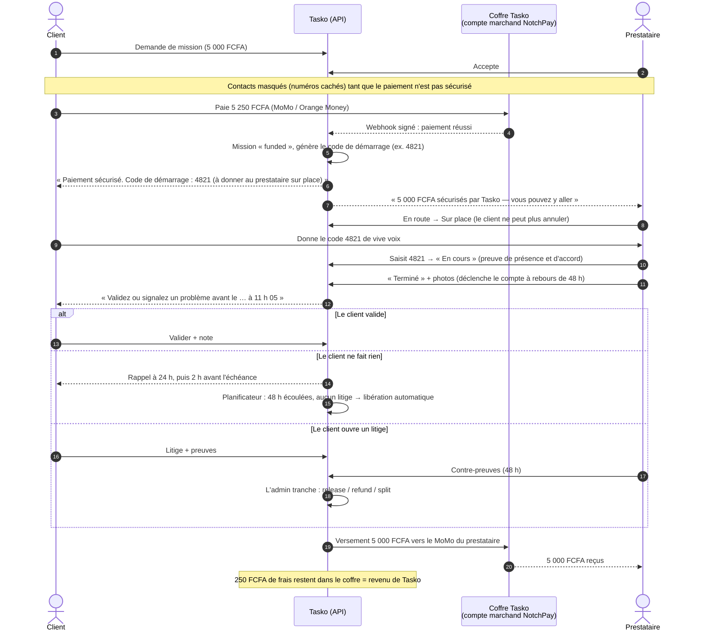
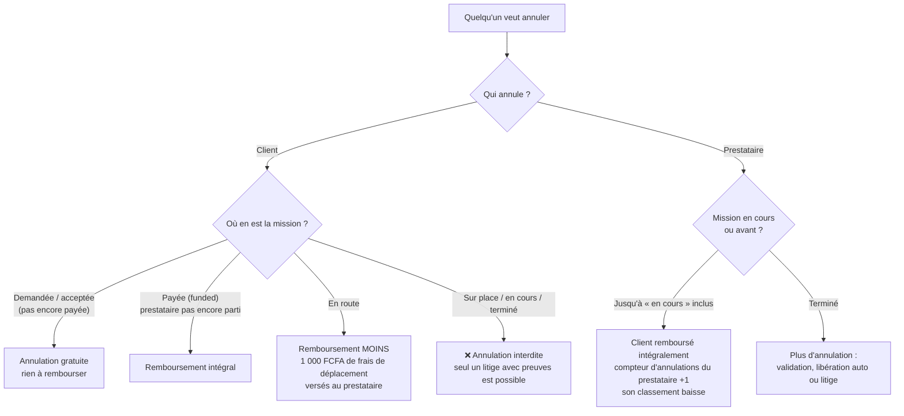
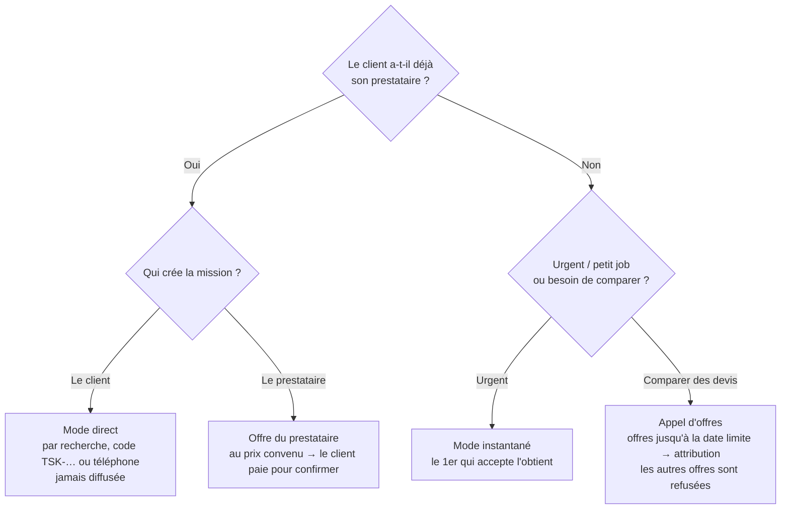
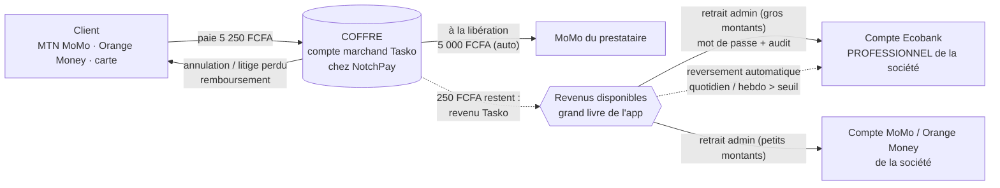
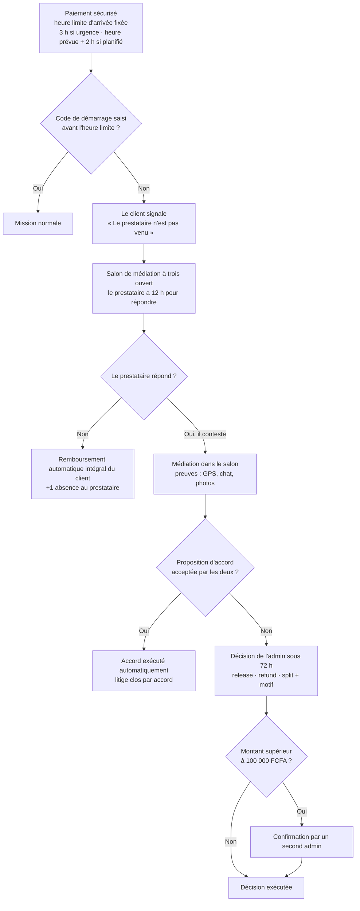

# Tasko — Confiance, garantie de paiement et trésorerie (V2)

> Ce document répond, en langage simple, aux quatre questions posées par le porteur du projet :
>
> 1. **Le client malhonnête** : comment être sûr que le prestataire sera payé après le travail ?
> 2. **L'accord déjà conclu** : si le client a déjà son prestataire, que devient l'appel d'offres ?
> 3. **Les entreprises et les propriétaires immobiliers** : comment utilisent-ils Tasko ?
> 4. **Les revenus du propriétaire de Tasko** : où est l'argent et comment le récupérer (Mobile Money, Ecobank) ?
>
> Les règles citées (RG-G1 à RG-G9, modes `instant` / `direct` / `tender`, jalons, trésorerie) sont celles de la **section 5 du [contrat d'API](05-contrat-api.md#5-v2--garantie-de-paiement-gré-à-gré-appels-doffres-immobilier-trésorerie)**, qui fait foi. Les valeurs par défaut (48 h, 1 000 FCFA…) sont des **paramètres modifiables** par l'administrateur.
>
> ⚠️ Les passages juridiques, fiscaux et bancaires sont des **pistes de travail**, pas un avis juridique. Ils doivent être validés par un juriste et un expert-comptable au Cameroun avant la mise en production.

---

## Sommaire

1. [Question 1 — Le client malhonnête : comment le prestataire est-il sûr d'être payé ?](#1-question-1--le-client-malhonnête--comment-le-prestataire-est-il-sûr-dêtre-payé-)
2. [Les règles de la garantie de paiement (RG-G1 à RG-G9) en langage simple](#2-les-règles-de-la-garantie-de-paiement-rg-g1-à-rg-g9-en-langage-simple)
3. [Scénarios concrets](#3-scénarios-concrets)
4. [Question 2 — « J'ai déjà trouvé mon prestataire » : les modes de mission](#4-question-2--jai-déjà-trouvé-mon-prestataire--les-modes-de-mission)
5. [Question 3 — Entreprises et propriétaires immobiliers](#5-question-3--entreprises-et-propriétaires-immobiliers)
6. [Question 4 — Comment le propriétaire de Tasko récupère ses revenus](#6-question-4--comment-le-propriétaire-de-tasko-récupère-ses-revenus)
7. [Médiation à trois et prestataire absent (RG-G10 à RG-G15)](#7-médiation-à-trois-et-prestataire-absent-rg-g10-à-rg-g15)
8. [FAQ](#8-faq)

---

## 1. Question 1 — Le client malhonnête : comment le prestataire est-il sûr d'être payé ?

> *« Il y a des clients malhonnêtes : le prestataire fait le travail au prix convenu mais à la fin le client ne paie pas ou ne valide pas. Comment être certain à 100 % qu'après le travail il sera payé ? »*

### 1.1 La réponse courte

**Sur Tasko, le client ne paie pas à la fin : il a déjà payé avant que le travail commence.**

- Le client paie **avant** que le prestataire ne se déplace. L'argent est **encaissé et bloqué** (séquestre) par Tasko via son partenaire de paiement.
- Le prestataire voit sur son téléphone : **« 5 000 FCFA sécurisés par Tasko — vous pouvez y aller »**. Tant que ce message n'apparaît pas, l'application **l'empêche** de démarrer la mission. Il ne se déplace donc jamais « pour rien ».
- À la fin, le client n'a plus qu'un choix : **valider** (l'argent part chez le prestataire) ou **contester avec des preuves**. S'il ne fait **rien**, l'argent est **libéré automatiquement au bout de 48 h**. **Le silence vaut acceptation.**
- Une fois le prestataire **arrivé**, le client **ne peut plus annuler**. Il ne peut plus « récupérer » son argent en disparaissant.

### 1.2 Ce qui est garanti à 100 %, et ce qui ne l'est pas (soyons honnêtes)

| Garanti à 100 % | Pas garanti automatiquement |
|---|---|
| **L'argent existe** : il a été réellement prélevé sur le compte Mobile Money du client avant le départ du prestataire. | Que le client soit **d'accord** avec la qualité du travail. |
| **L'argent est bloqué** : le client ne peut plus le reprendre seul, ni l'utiliser ailleurs. | Si le client ouvre un **litige**, l'argent reste bloqué jusqu'à la décision de Tasko. |
| Si le client **ne fait rien**, le prestataire est payé automatiquement après 48 h. | — |
| Le client **ne peut pas annuler** une fois le prestataire sur place. | — |

Le seul moyen pour un client de bloquer le paiement est d'**ouvrir un litige** — et un litige se gagne **avec des preuves**, pas avec des cris. Tasko examine le dossier et tranche : tout au prestataire, tout au client, ou un **partage** (exemple : travail fait aux trois quarts → 75 % au prestataire).

**Pourquoi c'est équitable** : la même règle protège le client honnête contre le prestataire qui bâcle ou ne vient pas. Si Tasko payait le prestataire *quoi qu'il arrive*, aucun client n'oserait payer d'avance, et le système s'écroulerait. Le séquestre + l'arbitrage sur preuves est le point d'équilibre : **le prestataire honnête est payé, le client honnête est protégé, le tricheur — d'un côté ou de l'autre — perd.**

### 1.3 Ce qu'il faut au prestataire pour gagner un litige

| Preuve | Pourquoi elle compte | Comment l'obtenir |
|---|---|---|
| **Code de démarrage** saisi | Prouve que le client était présent et a **donné son accord** pour commencer (seul le client voit ce code de 4 chiffres). | Le demander au client à l'arrivée, avant de commencer. |
| **Photos avant / après** jointes à « Terminé » | Prouvent l'état du travail. | Bouton « Terminé » → ajouter les photos. |
| **Discussion dans le chat Tasko** | Le chat est **versé au dossier** : prix convenu, demandes du client, accord sur les modifications. | Tout se dire dans l'app, pas sur WhatsApp. |
| **Horodatages et position GPS** | « En route » à 9 h, « Sur place » à 9 h 20, « Terminé » à 11 h 05 : l'historique est enregistré automatiquement. | Mettre à jour les statuts au bon moment. |
| **Réponse dans les 48 h** au litige | Après le délai de réponse, l'admin tranche avec ce qu'il a. | Répondre depuis l'écran du litige avec message + photos. |

> 💡 **Conseil à donner à tous les prestataires** : « Code de démarrage, photos, chat dans l'app. Avec ces trois éléments, un litige abusif est perdu par le client. »

### 1.4 Séquence complète du paiement sécurisé

### 1.5 Arbre de décision d'une annulation

---

## 2. Les règles de la garantie de paiement (RG-G1 à RG-G9) en langage simple

| Règle | Nom | En une phrase | Qui est protégé |
|---|---|---|---|
| **RG-G1** | Séquestre préalable | Le prestataire **ne peut pas** passer « En route », « Sur place » ou « En cours » tant que l'argent n'est pas encaissé et bloqué. | Prestataire |
| **RG-G2** | Code de démarrage | Après paiement, le client reçoit un **code à 4 chiffres** ; le prestataire doit le saisir pour commencer — c'est la preuve que le client était là et d'accord. | Les deux |
| **RG-G3** | Preuve de fin | En déclarant « Terminé », le prestataire joint des **photos** et une note (photos obligatoires si l'admin l'active). | Prestataire |
| **RG-G4** | Libération automatique | **48 h** après « Terminé », sans litige, l'argent est **versé automatiquement** au prestataire. Rappels au client à mi-parcours et 2 h avant. | Prestataire |
| **RG-G5** | Annulation encadrée | Gratuite avant paiement ; remboursement intégral si payé mais pas parti ; **1 000 FCFA retenus pour le prestataire** s'il est en route ; **impossible** une fois arrivé. Un prestataire qui annule rembourse intégralement le client et est pénalisé dans son classement. | Les deux |
| **RG-G6** | Litige arbitré | Ouvrable de « payé » à « terminé » (avant les 48 h). **Gèle** la libération automatique. Chaque partie a **48 h** pour déposer ses preuves ; le chat est versé au dossier. Tasko décide : tout au prestataire, tout au client ou **partage**. | Les deux |
| **RG-G7** | Réputation du client | Le prestataire **note aussi le client**. Avant d'accepter, il voit : note du client, missions payées, **litiges perdus**. À 3 litiges perdus, le client est signalé à l'admin (avertissement, suspension). | Prestataire |
| **RG-G8** | Anti-contournement | Tant que le paiement n'est pas sécurisé, **les numéros de téléphone sont cachés** et ceux écrits dans le chat sont masqués (« 6•• •• •• •• — visible après paiement sécurisé »). | Tasko, et le prestataire (pas de « on règle en cash après ») |
| **RG-G9** | Fiabilité des opérations | Chaque mouvement d'argent est fait **une seule fois** et **en entier** (verrous en base, opérations idempotentes) : impossible de payer deux fois un prestataire ou de rembourser deux fois un client. | Tout le monde, et la trésorerie de Tasko |
| **RG-G10 à G15** | Médiation à trois et prestataire absent | Pas de remboursement décidé par le client seul, règle « prestataire absent », salon à trois, accord amiable, décision sous 72 h avec double validation au-delà de 100 000 FCFA — voir [§ 7](#7-médiation-à-trois-et-prestataire-absent-rg-g10-à-rg-g15). | Les deux |

---

## 3. Scénarios concrets

### Scénario A — Le client malhonnête qui ne valide pas

| Moment | Ce qui se passe |
|---|---|
| Lundi 9 h | M. X commande la réparation d'un portail à 20 000 FCFA. Il paie **21 000 FCFA** (frais 5 %). Le soudeur Paul voit « 20 000 FCFA sécurisés ». |
| Lundi 10 h | Paul arrive, M. X lui donne le code **7316**, Paul démarre. |
| Lundi 14 h | Travail fini. Paul passe « Terminé » avec 3 photos. |
| Lundi 14 h → Mercredi 14 h | M. X ne répond plus, espérant ne pas payer. Rappels envoyés mardi 14 h et mercredi 12 h. |
| **Mercredi 14 h** | **Libération automatique** : Paul reçoit 20 000 FCFA sur son MoMo. Tasko garde 1 000 FCFA. M. X ne peut plus rien faire. |

**Résultat : le silence ne protège pas le client malhonnête. Paul est payé sans rien demander.**

### Scénario B — Le litige abusif

| Moment | Ce qui se passe |
|---|---|
| J | Mme Y fait peindre un salon à 40 000 FCFA (payé d'avance : 42 000). La peintre Clarisse saisit le code de démarrage, travaille, passe « Terminé » avec photos. |
| J + 1 | Mme Y ouvre un litige : « Travail non fait ». La libération automatique est **gelée**. |
| J + 1 → J + 3 | Clarisse dépose ses preuves : code de démarrage saisi à 8 h 12, photos avant/après, message de Mme Y dans le chat à 16 h : « C'est très joli merci ». Mme Y n'apporte aucune photo. |
| J + 3 | L'admin tranche **`release`** : Clarisse reçoit 40 000 FCFA. Mme Y compte **1 litige perdu**, visible des prochains prestataires ; au 3ᵉ, son compte est signalé et peut être suspendu. |

**Résultat : le litige abusif retarde le paiement de quelques jours mais ne l'empêche pas ; il coûte sa réputation au client.**

### Scénario C — Le prestataire qui ne vient pas (mis à jour avec la règle « prestataire absent »)

| Cas | Ce qui se passe |
|---|---|
| Il annule lui-même | Le client est **remboursé intégralement** ; le prestataire prend +1 annulation (classement dégradé, suspension possible en cas de répétition). |
| Il ne bouge pas, mission restée « payée » | Le client peut encore annuler avant l'arrivée (RG-G5) : **remboursement intégral** (aucun frais avant le départ). |
| Il ne vient pas, ou se déclare « En route » mais n'arrive jamais | Le client **n'annule pas** (en « En route », cela coûterait 1 000 FCFA) : à l'**heure limite d'arrivée** (3 h après le paiement pour une urgence, 2 h après l'heure prévue pour une mission planifiée), si le code de démarrage n'a pas été saisi, il appuie sur **« Le prestataire n'est pas venu »**. Un salon de médiation à trois s'ouvre ; le prestataire a **12 h** pour répondre. **Sans réponse → remboursement automatique intégral** du client, et +1 « absence » au compteur du prestataire. S'il conteste (« je suis venu, la porte était fermée »), Tasko décide sur preuves (GPS, chat). Voir [§ 7](#7-médiation-à-trois-et-prestataire-absent-rg-g10-à-rg-g15). |

### Scénario E — L'accord amiable à trois (3 000 / 2 000 FCFA)

| Moment | Ce qui se passe |
|---|---|
| J, 10 h | Une cliente paie 5 000 FCFA (+ 250 de frais) pour le montage de deux meubles. Le monteur, Hervé, saisit le code de démarrage, monte le premier meuble, mais une pièce du second manque ; il passe « Terminé ». |
| J, 12 h | La cliente ouvre un litige « travail incomplet » au lieu de valider. Un **salon à trois** s'ouvre : la cliente, Hervé et le médiateur Tasko voient les mêmes messages, qui ne peuvent être ni modifiés ni supprimés. |
| J, 13 h | Chacun s'explique avec photos. Le médiateur publie une **proposition de règlement** : **3 000 FCFA à Hervé** (meuble monté et déplacement), **2 000 FCFA remboursés** à la cliente. |
| J, 14 h | La cliente **accepte**, Hervé **accepte** → l'accord est **exécuté automatiquement** : 3 000 FCFA sur le MoMo d'Hervé, 2 000 FCFA rendus à la cliente. Litige clos « par accord » ; personne n'est compté comme perdant. |

**Résultat : le problème est réglé en quelques heures, en transparence, sans attendre la décision de l'admin.**

### Scénario D — Le client qui annule pendant que le prestataire est en route

| Moment | Ce qui se passe |
|---|---|
| 10 h 00 | Tresses commandées à 12 000 FCFA, payées 12 600 FCFA. |
| 10 h 15 | Mireille part ; statut « En route ». |
| 10 h 25 | La cliente annule (« finalement ma sœur va me coiffer »). |
| Effet | La cliente est remboursée de **12 600 − 1 000 = 11 600 FCFA** ; Mireille reçoit **1 000 FCFA de frais de déplacement** (plafonnés au prix de la mission). |
| Si Mireille était déjà « Sur place » | **Annulation impossible.** La cliente ne peut que valider ou ouvrir un litige. |

---

## 4. Question 2 — « J'ai déjà trouvé mon prestataire » : les modes de mission

> *« Si une personne a déjà trouvé son prestataire et qu'ils se sont déjà entendus, l'appel d'offres on en fait quoi ? Est-il prévu que plus personne ne puisse se proposer si le client a son prestataire ? »*

**Réponse : oui.** L'appel d'offres n'est **qu'un des modes** de Tasko. Quand le client a déjà son prestataire, la mission **n'est jamais diffusée** : personne d'autre ne la voit, personne ne peut se proposer.

| Mode | Quand l'utiliser | Qui voit la mission ? | Qui peut se proposer ? |
|---|---|---|---|
| **Instantané** (`instant`, style Yango) | Urgence, petit job : « une fuite, maintenant » | Les prestataires proches ayant la compétence | **Le premier qui accepte l'obtient.** Les autres reçoivent instantanément « Cette mission a déjà été attribuée » ; elle disparaît de leur liste. |
| **Gré à gré direct** (`direct`) | « J'ai déjà mon prestataire » | **Uniquement** le prestataire choisi | Lui seul : il accepte ou refuse. Le client le trouve par la recherche, son **code Tasko** (ex. `TSK-7F3K9`) ou son **numéro de téléphone**. |
| **Offre du prestataire** (`direct`, créée par le prestataire) | L'accord a été conclu **hors de l'app** (au marché, par téléphone) | Uniquement le client concerné | Personne d'autre : le prestataire crée lui-même la mission **au prix convenu**. Le client reçoit « Bika Services vous propose : … 5 000 FCFA — **Payer pour confirmer** ». |
| **Appel d'offres** (`tender`) | Entreprise, propriétaire, gros travaux : on veut **comparer plusieurs devis** | Prestataires de la compétence dans la ville (`public`) ou **seulement ceux invités** (`invited`) | Tous ceux qui la voient, **jusqu'à la date limite**. Dès que le client **attribue** une offre, toutes les autres sont **refusées** automatiquement et **plus personne ne peut se proposer**. |

### Pourquoi un accord conclu hors de l'app doit quand même passer par Tasko

| Sans Tasko (cash / WhatsApp) | Avec Tasko (mode direct ou offre du prestataire) |
|---|---|
| Le prestataire travaille **sans savoir** si le client paiera. | L'argent est **bloqué avant** son déplacement ; payé automatiquement à 48 h. |
| Le client paie d'avance **sans recours** si le travail est bâclé. | Le client peut ouvrir un **litige** arbitré sur preuves. |
| Aucun justificatif. | **Reçu** numéroté (indispensable pour une entreprise ou un propriétaire). |
| La mission ne compte pas dans la réputation. | Note, avis, missions réalisées, niveau « Recommandé » : la réputation **ne se construit que sur des missions payées via Tasko**. |
| Pour 5 000 FCFA de travail : 0 FCFA de frais, mais **tout le risque**. | Pour 5 000 FCFA de travail : 250 FCFA de frais pour le client, et **zéro risque d'impayé** pour le prestataire. |

> Message à porter sur le terrain : **« Vous vous êtes déjà mis d'accord ? Parfait. Faites passer l'accord par Tasko : vous êtes payé à coup sûr, et chaque mission fait monter votre note. »**

---

## 5. Question 3 — Entreprises et propriétaires immobiliers

### 5.1 Entreprises (compte Business)

| Besoin d'une entreprise | Réponse Tasko V2 |
|---|---|
| Comparer plusieurs devis pour des travaux | **Appel d'offres** public ou sur invitation, date limite, comparaison prix / délai / note / missions / jalons, attribution en un clic. |
| Être en règle avec la comptabilité | **Compte Business** (raison sociale, NIU, RCCM, adresse) et **reçu** par mission (`TSK-2026-000123`), imprimable. |
| Ne pas payer un chantier entier d'avance | **Jalons** : le chantier est découpé (ex. gros œuvre 200 000 · finitions 250 000) ; chaque jalon est payé et bloqué **avant** son exécution, puis libéré à sa validation (ou automatiquement 48 h après). |
| Garder ses bons prestataires | Mode **direct** vers un prestataire attitré ; **missions récurrentes**. |

**Exemple de jalons** — rénovation d'un bureau à 450 000 FCFA :

| Jalon | Montant | Le client paie… | Le prestataire voit… | Libération |
|---|---|---|---|---|
| 1. Gros œuvre | 200 000 | au démarrage | « Jalon 1/2 : 200 000 FCFA sécurisés » | à la validation du jalon 1 (ou 48 h) |
| 2. Finitions | 250 000 | quand le jalon 1 est validé | « Jalon 2/2 : 250 000 FCFA sécurisés » | à la validation finale (ou 48 h) |

L'entreprise n'avance jamais plus que l'étape en cours ; l'artisan ne travaille jamais sur une étape non financée.

### 5.2 Propriétaires immobiliers (bailleurs, agences, syndics)

| Besoin | Réponse Tasko V2 |
|---|---|
| Suivre plusieurs biens | **Biens** : appartement, maison, immeuble, terrain, local commercial — avec adresse et nombre de logements. |
| Savoir ce que coûte chaque bien | **Historique des interventions et total des dépenses par bien**. |
| Ménage, jardinage, maintenance réguliers | **Missions récurrentes** : hebdomadaire, toutes les deux semaines, mensuelle ; Tasko crée automatiquement la mission pour le **prestataire attitré** et prévient les deux parties ; le propriétaire paie pour la sécuriser comme d'habitude. |
| Un bon prestataire par métier | **Prestataires attitrés** (mode direct), favoris. |
| Justifier les charges | **Reçus** par mission, rattachés au bien. |

---

## 6. Question 4 — Comment le propriétaire de Tasko récupère ses revenus

> *« Est-ce que ça reste accumulé dans un coffre / portefeuille dans l'app que je transfère vers mon Mobile Money, ou ça entre directement dans mes comptes MoMo (Orange/MTN), ou dans mon compte bancaire Ecobank ? »*

### 6.1 La réponse courte

1. **L'argent des clients n'arrive ni sur votre MoMo personnel, ni directement chez Ecobank.** Il arrive sur le **compte marchand de Tasko chez l'agrégateur de paiement (NotchPay)**. C'est **le coffre**.
2. Dans ce coffre se mélangent trois sortes d'argent. L'application tient un **grand livre** qui les sépare au franc près :

| Poste (page Trésorerie) | C'est quoi ? | À qui est-ce ? |
|---|---|---|
| **Fonds séquestrés** (`escrow_held`) | Argent payé par les clients pour des missions **pas encore terminées** | Aux clients / prestataires — **intouchable** |
| **Dus aux prestataires** (`providers_available`) | Missions validées dont le versement au prestataire a échoué ou est en attente | Aux prestataires — **intouchable** |
| **Revenus disponibles** (`revenue_available`) | Frais de service + commissions + abonnements Pro + boosts + frais d'annulation conservés − remises − ce que vous avez déjà retiré | **À vous (à la société Tasko)** |

3. Vous **retirez vos revenus** depuis le back-office, page **Trésorerie** :
   - vers le **compte bancaire Ecobank** de la société, ou vers un **compte MTN MoMo / Orange Money** ;
   - le montant est **plafonné au disponible** (le serveur refuse tout retrait supérieur, même d'un franc) ;
   - **mot de passe re-demandé** à chaque retrait, et chaque retrait est inscrit au **journal d'audit** (qui, quand, combien, vers quel compte, depuis quelle adresse IP) ;
   - ou vous programmez un **reversement automatique** quotidien ou hebdomadaire vers le compte par défaut, au-delà d'un seuil (50 000 FCFA par défaut).

### 6.2 Le circuit de l'argent

Exemple d'un mois à 3 000 missions de 5 000 FCFA :

| Ligne | Montant |
|---|---|
| Encaissé auprès des clients (3 000 × 5 250) | 15 750 000 FCFA |
| Versé aux prestataires (3 000 × 5 000) | − 15 000 000 FCFA |
| **Revenu brut Tasko** (frais 250 × 3 000) | **750 000 FCFA** |
| Frais NotchPay d'encaissement (≈ 2 %) et de versement (≈ 1 %), *voir § 6.4* | ≈ − 465 000 FCFA |
| **Revenu net de paiement** | ≈ 285 000 FCFA |

Le coffre a vu passer 15,75 millions, mais **seuls ≈ 285 000 FCFA sont réellement à vous** (avant salaires, loyers, impôts). Le grand livre est là pour que vous ne confondiez **jamais** le volume qui transite avec votre revenu.

### 6.3 Recommandations (à valider par un juriste et un expert-comptable)

| # | Recommandation | Pourquoi |
|---|---|---|
| 1 | **Créer une société** (SARL, SAS ou SA selon les associés et le capital — choix à faire avec un juriste) | Les agrégateurs exigent une **vérification d'entreprise (KYB)** pour ouvrir un compte marchand en production (NotchPay indique un processus de vérification d'environ 1 à 2 jours ouvrés une fois le dossier complet — source ci-dessous) ; un compte marchand au nom d'une personne privée n'est ni adapté ni prudent. |
| 2 | **Ouvrir (ou utiliser) un compte Ecobank PROFESSIONNEL au nom de la société** et en faire le **compte de reversement principal** | Gros montants, traçabilité, relevés pour la comptabilité et le fisc, séparation nette entre l'argent de la société et le vôtre. |
| 3 | **Garder Mobile Money pour les petits retraits rapides** (compte MoMo / Orange Money **de la société** de préférence) | Les portefeuilles MoMo ont des **plafonds** de solde et de transaction ; ils ne conviennent pas pour sortir des millions. |
| 4 | **Ne jamais utiliser l'argent séquestré ou dû aux prestataires**, même « pour quelques jours » | C'est l'argent des clients et des prestataires : s'en servir expose à un **risque juridique sérieux** (détournement de fonds de tiers) et à la faillite au premier pic de remboursements. L'application l'empêche techniquement (retrait plafonné au disponible), mais la règle doit aussi être celle des dirigeants. |
| 5 | **Opérer le séquestre via un partenaire de paiement agréé** | La détention de fonds pour compte de tiers est réglementée en zone CEMAC (COBAC / BEAC). Tasko enregistre l'état logique ; l'argent reste chez le partenaire agréé. Faire valider le schéma par un juriste spécialisé. |
| 6 | **TVA et fiscalité** | Les frais de service et commissions sont le **chiffre d'affaires** de Tasko et sont en principe soumis à la TVA. Le taux de TVA au Cameroun est généralement cité à **19,25 %** (taux principal + centimes additionnels) — **à confirmer avec un expert-comptable**, de même que l'impôt sur les sociétés, la patente et les éventuelles retenues. Prévoir de mettre la TVA de côté à chaque retrait. |
| 7 | **Rapprochement mensuel** | Comparer chaque mois le solde réel du coffre NotchPay avec `escrow_held + providers_available + revenue_available` ; tout écart est un incident à investiguer. |

### 6.4 Ce que l'on sait de NotchPay (vérifié en ligne le 15/10/2026)

| Point | Ce qu'indique NotchPay | Statut |
|---|---|---|
| Versements (transferts) vers **MTN Mobile Money** et **Orange Money** au Cameroun | Pris en charge (création d'un bénéficiaire puis transfert, statut par webhook) | ✅ documenté — [docs Transfers](https://developer.notchpay.co/send-money/transfers) |
| Frais d'encaissement Mobile Money | **2 %** par paiement (« Local payments ») | ✅ page tarifs — [notchpay.co/pricing](https://notchpay.co/pricing) ; le pays exact n'est pas précisé : **à confirmer** |
| Frais de transfert / retrait vers Mobile Money | **1 %** par transfert | ✅ même page — **à confirmer pour le Cameroun** |
| Frais d'installation / mensuels | Aucun | ✅ [FAQ NotchPay](https://developer.notchpay.co/faq.md) |
| Vérification de l'entreprise | Processus de vérification, « généralement 1 à 2 jours ouvrés » | ✅ FAQ ; liste des pièces : **à vérifier auprès de NotchPay** |
| Reversement du solde vers un **compte bancaire Ecobank** | La documentation évoque des envois vers des comptes bancaires, sans détail pour le Cameroun (banques, délais, frais) | ⚠️ **À vérifier auprès de NotchPay** |
| Statut d'agrément pour détenir des fonds de tiers (séquestre) | Non précisé dans la documentation consultée | ⚠️ **À vérifier auprès de NotchPay et d'un juriste** |

Ces chiffres (2 % / 1 %) correspondent aux hypothèses du [modèle économique](02-modele-economique.md#3-unit-economics-dun-job-de-5-000-fcfa).

---

## 7. Médiation à trois et prestataire absent (RG-G10 à RG-G15)

> 💡 **Idée du porteur de projet, retenue dans le contrat d'API (§ 5.9)** : l'argent déposé **ne retourne jamais sur le Mobile Money du client par sa seule décision**. Quand il y a un problème, le client, le prestataire et Tasko se parlent dans un **salon à trois**, en toute transparence, avant l'échéance ; ensuite l'admin envoie l'argent à l'une des parties, ou le partage.

### 7.1 Les règles en langage simple

| Règle | Nom | En une phrase |
|---|---|---|
| **RG-G10** | Pas de remboursement « tout seul » | Le client **ne peut jamais récupérer seul** l'argent bloqué. Il n'est remboursé que si : le prestataire annule ; le client annule **avant l'arrivée** (RG-G5) ; le prestataire absent ne répond pas (RG-G11) ; les deux parties acceptent un accord (RG-G13) ; ou l'admin le décide. |
| **RG-G11** | Prestataire absent | Une **heure limite d'arrivée** est fixée : 3 h après le paiement pour une urgence, 2 h après l'heure prévue pour une mission planifiée. Si le code de démarrage n'a pas été saisi à cette heure, le client peut signaler « Le prestataire n'est pas venu ». Le prestataire a **12 h** pour répondre ; **sans réponse, le client est remboursé automatiquement** et le prestataire prend +1 absence. S'il conteste, l'admin décide. |
| **RG-G12** | Salon de médiation | Tout litige ouvre un **salon à trois** : client, prestataire, équipe Tasko (messages signés « Médiateur Tasko »). Le chat de la mission y est joint en lecture. Les preuves sont des messages du salon. **Rien ne peut être modifié ni supprimé** : tout est horodaté et fait foi. |
| **RG-G13** | Accord amiable | L'admin ou une partie propose un partage (ex. 3 000 FCFA au prestataire, 2 000 FCFA rendus au client). **Si les deux acceptent**, il est exécuté automatiquement et le litige est clos. Une nouvelle proposition remplace la précédente. |
| **RG-G14** | Échéances et décision | Pendant le litige, la libération automatique est gelée. L'admin doit décider dans les **72 h** (alerte à l'ouverture et 12 h avant). Sa décision (tout au prestataire, tout au client, ou partage) a un **motif obligatoire**, publié dans le salon. **Au-delà de 100 000 FCFA, un second admin doit confirmer** (double validation). |
| **RG-G15** | Conséquences | Le perdant d'un litige voit son compteur augmenter (litiges perdus pour le client ; litiges perdus ou absences pour le prestataire). Au 3ᵉ, l'admin reçoit une alerte de suspension. |

### 7.2 Parcours « prestataire absent »

### 7.3 Pourquoi c'est mieux pour tout le monde

- **Le prestataire** sait que l'argent ne peut pas « repartir » sur un simple clic du client.
- **Le client** n'est pas abandonné : si le prestataire ne vient pas et ne répond pas, il est remboursé automatiquement, sans attendre l'admin.
- **Tasko** règle la plupart des cas par accord, sans trancher, et garde une trace complète et infalsifiable en cas de contestation ; la double validation au-delà de 100 000 FCFA protège contre l'erreur ou la fraude d'un seul admin.

---

## 8. FAQ

**Le client peut-il récupérer son argent tout seul ?**
Non. Une fois l'argent bloqué, il ne retourne jamais sur son MoMo par sa seule décision (RG-G10). Il peut annuler **avant l'arrivée** du prestataire (avec 1 000 FCFA de frais de déplacement s'il était déjà en route) ; après, il ne peut que valider ou ouvrir un litige. Il est aussi remboursé si le prestataire annule, si le prestataire absent ne répond pas dans les 12 h, si les deux parties acceptent un accord, ou si l'admin le décide.

**Le prestataire peut-il commencer sans que le client ait payé ?**
Non. L'app bloque « En route », « Sur place » et « En cours » tant que l'argent n'est pas sécurisé (RG-G1).

**Et si le client dit « je te paie en cash à la fin » ?**
Le prestataire doit refuser : sans paiement dans Tasko, aucune garantie, aucun litige possible, aucune note. Les numéros sont d'ailleurs masqués avant paiement (RG-G8).

**Le client refuse de donner le code de démarrage. Que faire ?**
Ne pas commencer. Écrire dans le chat (« je suis sur place, merci de me donner le code »), rester visible « Sur place ». Le client ne peut plus annuler ; s'il bloque, le prestataire ouvre un litige : sa présence est prouvée par le statut et le GPS.

**48 h, ce n'est pas trop long pour le prestataire ?**
C'est un équilibre : assez pour que le client vérifie (une fuite qui reprend, une peinture qui coule), assez court pour le prestataire. Le délai est un paramètre réglable par l'admin. La plupart des clients valident tout de suite.

**Que se passe-t-il si NotchPay n'arrive pas à verser l'argent au prestataire ?**
L'argent reste dans son **portefeuille Tasko** (« disponible ») et il peut le retirer manuellement vers son MoMo. Cet argent reste intouchable pour Tasko.

**Un litige peut-il durer indéfiniment ?**
Non : chaque partie a 48 h pour déposer ses preuves, puis l'admin tranche (objectif < 72 h).

**Et si c'est le prestataire qui est malhonnête (travail bâclé) ?**
Le client ouvre un litige avant la fin des 48 h, avec photos. L'admin peut rembourser tout ou partie.

**Dans le mode instantané, deux prestataires peuvent-ils accepter en même temps ?**
Non. L'acceptation est atomique : un seul gagne, les autres reçoivent « Cette mission a déjà été attribuée ».

**Un appel d'offres déjà attribué peut-il recevoir de nouvelles offres ?**
Non. Après attribution ou après la date limite, toute nouvelle offre est refusée.

**Puis-je retirer tout ce qu'il y a sur le compte NotchPay ?**
Non, seulement les **revenus disponibles**. Le reste appartient aux clients et aux prestataires. L'application refuse tout retrait supérieur.

**Mes revenus arrivent-ils automatiquement sur mon compte ?**
Seulement si vous activez le **reversement automatique** (quotidien ou hebdomadaire, au-delà d'un seuil). Sinon, ils s'accumulent dans le coffre et vous les retirez quand vous voulez depuis la page Trésorerie.

**Faut-il absolument une société ?**
Pour un compte marchand en production, une banque professionnelle et une fiscalité saine : oui, c'est fortement recommandé. Le choix de la forme (SARL, SAS…) se fait avec un juriste.

---

*Sources NotchPay consultées le 15/10/2026 : [Transfers](https://developer.notchpay.co/send-money/transfers) · [FAQ](https://developer.notchpay.co/faq.md) · [Tarifs](https://notchpay.co/pricing).*

*Documents associés : [01 — Description](01-description-projet.md) · [02 — Modèle économique](02-modele-economique.md) · [03 — Cahier des charges](03-cahier-des-charges.md) · [04 — Architecture](04-architecture-et-donnees.md) · [05 — Contrat d'API](05-contrat-api.md) · [06 — Parcours](06-parcours-utilisateurs.md) · [07 — Roadmap](07-roadmap-et-lancement.md)*
